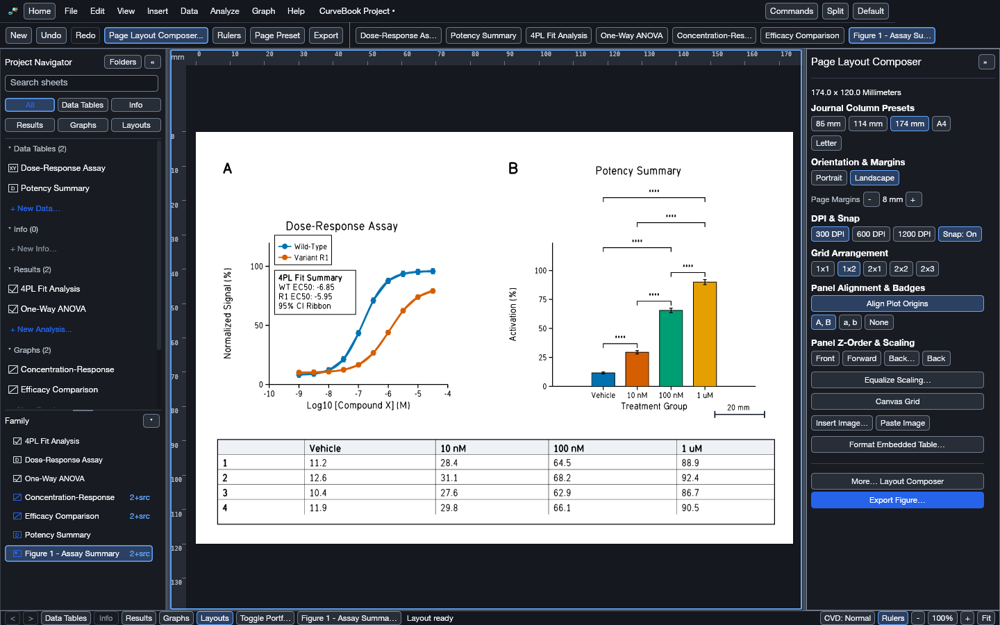

# CurveBook

[](https://github.com/HauserGroup/curvebook/actions/workflows/ci.yml)
[](#license-and-privacy)

<p align="center">
  
</p>

**CurveBook** is an open-source, clean-room biostatistics, nonlinear regression, and scientific graphing application written in pure Rust.

All calculations run locally on your computer with **zero telemetry**. You can work interactively in the **desktop application**, automate pipelines with the **command-line runner** (`curvebook-cli`), or analyze data through an **AI assistant** using the built-in Model Context Protocol server (`curvebook-cli mcp`).

- **Website:** [hausergroup.github.io/curvebook](https://hausergroup.github.io/curvebook/)
- **Documentation:** [Online Manual](https://hausergroup.github.io/curvebook/manual/) · [Repository Docs](docs/README.md)
- **Downloads:** [Latest Release (GitHub Releases)](https://github.com/HauserGroup/curvebook/releases)
- **Known Issues (Beta):** [Beta Known Issues & Release Scope](docs/release/beta-known-issues.md)

## What You Can Do

- **Structured Data Tables & Formulas:** Enter, paste, or link data across structured table types (`XY`, `Column`, `Grouped`, `Contingency`, `Survival`, `Parts of Whole`, `Multiple Variables`, and `Nested`), compute live `=` Calculated Variables, and exclude outliers with recorded audit notes.
- **Biostatistics & Curve Fitting:** Run parametric and nonparametric group comparisons, one-way/multi-way ANOVA, REML mixed models, multiplicity adjustments, survival and contingency analyses, ROC, GLMs, PCA/clustering, power & sample size planning, and built-in or custom nonlinear regression with profile-likelihood confidence intervals.
- **Publication Graphs & Page Layouts:** Build customizable scientific graphs and multi-panel Page Layouts, copy editable vector figures directly to the system clipboard, and export to `SVG`, `PDF`, `PNG`, `TIFF`, `EMF`, `CSV`, or `TSV`.
- **Self-Contained Projects:** Save data tables, notes, analyses, graphs, and layouts together in one `.curvebook` file (or Git-friendly `.curvebook.d/` directory), reuse pipelines with `.cbtemplate` templates, and import `.csv`, `.tsv`, `.pzfx`, and `.prism` files.

<p align="center">
  <br>
  <em>Split workspace (Light theme): Project Navigator, Family lineage tree, XY data grid, live 4PL nonlinear fit, and Format Inspector.</em>
</p>

<p align="center">
  <br>
  <em>Page Layout view (Dark theme): multi-panel figure with significance brackets, embedded summary table, physical millimeter rulers, and Page Layout controls.</em>
</p>

## Download and Install (Beta)

Download the installer for your computer from **[GitHub Releases](https://github.com/HauserGroup/curvebook/releases)** (Beta builds are listed as prereleases). Each kept installer already includes both the desktop app (`curvebook`) and the CLI/MCP executable (`curvebook-cli`), so no separate CLI download is required.

### Which file do I need?

| Operating System | Architecture | File to Download | Status & Notes |
|---|---|---|---|
| **macOS** | Apple Silicon & Intel (`universal`) | `curvebook-<version>-macos-universal.dmg` | Signed & notarized universal app (`CurveBook.app`, with `curvebook-cli` inside the bundle). |
| **Windows 10/11** | 64-bit Intel/AMD (`x64`) | `curvebook-<version>-windows-x64.msi` | **Unsigned** until post-Beta Authenticode signing (`R8.11`); see SmartScreen note below. |
| **Windows 10/11** | Windows on Arm (`arm64`) | `curvebook-<version>-windows-arm64.msi` | **Unsigned** until post-Beta Authenticode signing (`R8.11`); see SmartScreen note below. |
| **Linux** | 64-bit x86 (`x86_64`) | `curvebook-<version>-linux-x86_64.AppImage` | Single-file AppImage bundling both `curvebook` and `curvebook-cli`. |
| **Linux** | 64-bit Arm (`aarch64`) | `curvebook-<version>-linux-aarch64.AppImage` | Single-file AppImage bundling both `curvebook` and `curvebook-cli`. |
| **FreeBSD** | 64-bit x86 (`x86_64`) | `curvebook-<version>-freebsd-x86_64.tar.gz` | **Preview** desktop GUI & CLI archive. |
| **Browser** | WebAssembly (`curvebook-web`) | *Not shipped in Beta* | Deferred to **1.0** (`R0.28`, `R11`). |

*(Note: Legacy Windows 32-bit `x86` installers, Windows `-portable.zip`, separate macOS CLI `.zip`, and Linux `.deb`/`.rpm`/`.tar.gz`/Flatpak packages are no longer shipped starting with Beta. See [`docs/release/beta-known-issues.md`](docs/release/beta-known-issues.md) for details.)*

### Platform Install Steps

- **macOS:**
  1. Open `curvebook-<version>-macos-universal.dmg` and drag **CurveBook.app** into **Applications**.
  2. Launch **CurveBook** from Applications.
  3. **Using `curvebook-cli` / MCP:** `curvebook-cli` lives inside `CurveBook.app/Contents/MacOS/curvebook-cli`.
     - For MCP clients such as Claude Desktop, use the full path `/Applications/CurveBook.app/Contents/MacOS/curvebook-cli`.
     - To run `curvebook-cli` in your terminal, add it to `PATH` (for zsh, add to `~/.zshrc`):
       ```sh
       export PATH="/Applications/CurveBook.app/Contents/MacOS:$PATH"
       ```
- **Windows (`x64` / `arm64`):**
  1. Verify the downloaded `.msi` checksum and attestation first (see [Verifying Your Download](#verifying-your-download)).
  2. Double-click `curvebook-<version>-windows-x64.msi` (or `-arm64.msi`). Because Beta Windows installers are **unsigned** (`R8.11`), Windows Defender SmartScreen displays an *Unknown publisher* prompt: click **More info** and then **Run anyway**.
     - *Windows 11 Smart App Control & managed PCs:* Where **Smart App Control** is enabled, or on managed lab/university computers that block unsigned software, Windows blocks unsigned installers with no override option. A Microsoft-signed Microsoft Store package is planned separately (`R8.9`).
  3. Follow the Setup Wizard (defaults to installing for your account under `%LOCALAPPDATA%\Programs\CurveBook\`, with an option to install for everyone under `Program Files\CurveBook\`). Both `curvebook.exe` and `curvebook-cli.exe` are placed in that install folder.
- **Linux (`.AppImage`):**
  1. Make the AppImage executable and launch it:
     ```sh
     chmod +x curvebook-<version>-linux-x86_64.AppImage
     ./curvebook-<version>-linux-x86_64.AppImage
     ```
     *(Requires FUSE such as `libfuse2`/`fuse3`; if FUSE is unavailable, pass `--appimage-extract-and-run`.)*
  2. To invoke `curvebook-cli` directly (for example from an MCP client or script), extract the AppImage once with `--appimage-extract` and point to `squashfs-root/usr/bin/curvebook-cli`.
- **FreeBSD (`x86_64` preview):**
  1. Extract the archive and run `bin/curvebook` or `bin/curvebook-cli`:
     ```sh
     tar -xzf curvebook-<version>-freebsd-x86_64.tar.gz
     cd curvebook-<version>-freebsd-x86_64
     ./bin/curvebook
     ```

## Verifying Your Download

Every release file includes a SHA-256 checksum in `SHA256SUMS.txt` and a keyless [Sigstore](https://www.sigstore.dev/) build provenance attestation generated by CurveBook's GitHub Actions release workflow.

Put your downloaded installer and `SHA256SUMS.txt` in the same folder, then verify **both** provenance and checksum:

1. **Check build provenance** using the [GitHub CLI](https://cli.github.com/) (`gh`, signed in with `gh auth login`):

   ```sh
   gh attestation verify SHA256SUMS.txt --repo HauserGroup/curvebook \
     --signer-workflow HauserGroup/curvebook/.github/workflows/release.yml
   ```

   For tag-built releases, you can also pin the release tag with `--source-ref refs/tags/v<version>`.

2. **Verify your downloaded file against `SHA256SUMS.txt`:**
   - **macOS:** `shasum -a 256 --check --ignore-missing SHA256SUMS.txt`
   - **Linux:** `sha256sum --check --ignore-missing SHA256SUMS.txt`
   - **Windows (PowerShell):**
     ```powershell
     $f = "curvebook-<version>-windows-x64.msi"
     $expected = (Select-String -Path SHA256SUMS.txt -SimpleMatch "  $f").Line.Split(" ")[0]
     (Get-FileHash $f -Algorithm SHA256).Hash -eq $expected.ToUpper()
     ```
   - **FreeBSD:** see [`docs/release/verifying-downloads.md`](docs/release/verifying-downloads.md) for the `sha256` check command.

Full verification instructions and details on why Linux and FreeBSD downloads use Sigstore attestations instead of separate signature files are in [`docs/release/verifying-downloads.md`](docs/release/verifying-downloads.md).

## Your First Analysis

You can run your first analysis directly in the desktop window or through an AI assistant connected over MCP.

### 1. In the Desktop Application (`curvebook`)

1. Launch **CurveBook**. The **Welcome & New Data Table** screen opens automatically (`File › New Project` or **New** on the toolbar reopens it anytime).
2. Choose a data table type on the left (such as **Column** or **XY**), or switch to the **Tutorial Sample Data** tab to start with a ready-made dataset.
3. Click **Create Table** (or **Open Sample Dataset**), then click or double-click cells in the grid to enter or paste (`Cmd/Ctrl+V`) measurements.
4. Click **Analyze** on the toolbar (or **Analyze › Analyze…**, `Cmd/Ctrl+Shift+A`), select a test or curve fit (for example **t tests (Unpaired / Welch / Paired / Nonparametric)** or **Nonlinear Regression (Curve Fitting)**), and confirm with **OK**.
5. Inspect the live Results sheet and linked Graph, customize appearance in the right-hand **Format Inspector**, copy vector figures with `Cmd/Ctrl+C`, and save or export via **File › Save** (`.curvebook`) or **File › Export…** (`SVG`, `PDF`, `PNG`, `TIFF`).

### 2. Through an AI Assistant (MCP)

Follow the step-by-step **[Beginner's Guide to using CurveBook with your AI assistant](docs/mcp-for-beginners.md)** to connect `curvebook-cli mcp --workdir <your-data-folder>` to Claude Desktop or another local MCP client, run a Welch's *t*-test by asking in plain language, and save your work as a `.curvebook` project.

For MCP framing details, attaching to a shared desktop window (`curvebook --control <port> --window`), `--gui-only` mode, and troubleshooting, see [`docs/mcp.md`](docs/mcp.md).

## Documentation, Known Issues & Getting Help

- **Online Manual & Reference:** [hausergroup.github.io/curvebook/manual/](https://hausergroup.github.io/curvebook/manual/)
- **Repository Documentation Index:** [`docs/README.md`](docs/README.md)
- **Known Issues & Release Notes:** [`docs/release/beta-known-issues.md`](docs/release/beta-known-issues.md) (historical Alpha notes: [`docs/release/alpha-known-issues.md`](docs/release/alpha-known-issues.md))
- **Report a Bug or Numerical Issue:** Open a [Bug Report](.github/ISSUE_TEMPLATE/bug_report.yml), [Numerical Result Report](.github/ISSUE_TEMPLATE/numerical_result.yml), or [Feature Request](.github/ISSUE_TEMPLATE/feature_request.yml) via GitHub Issues (avoid attaching unpublished or confidential research data).
- **Security Vulnerabilities:** Report privately following [`SECURITY.md`](SECURITY.md).

## License and Privacy

- **Privacy & Zero Telemetry:** Read the full [Privacy Policy](https://hausergroup.github.io/curvebook/privacy.html). CurveBook collects **zero telemetry, analytics, or crash reports**, makes **zero outbound network connections**, and includes **no auto-updater** (`cargo xtask telemetry`).
- **License:** Dual-licensed under **`MIT OR Apache-2.0`** ([`LICENSE-MIT`](LICENSE-MIT), [`LICENSE-APACHE`](LICENSE-APACHE)).
- **Clean-Room Development:** CurveBook is implemented independently in pure Rust from published statistical literature and public file-format specifications, without copying proprietary commercial software code, equations, wording, templates, or assets, and without copyleft (`GPL`/`AGPL`/`LGPL`) dependencies. Third-party notices and asset attributions live in [`ASSETS.md`](ASSETS.md), [`ATTRIBUTION.md`](ATTRIBUTION.md), [`NOTICE`](NOTICE), and [`docs/licences.md`](docs/licences.md).

## Contributing & Building from Source

Want to build CurveBook from source, run the workspace test and oracle suites, or submit a pull request?

- Start with [`CONTRIBUTING.md`](CONTRIBUTING.md), [`docs/development.md`](docs/development.md), and [`AGENTS.md`](AGENTS.md).
- Contributor credits are maintained in [`docs/contributors.md`](docs/contributors.md).
