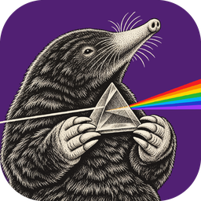

# LumenCraft

[](https://github.com/lumencraft/lumencraft/actions/workflows/ci.yml)
[](#clean-room--licensing)
[](#quick-start)

[Capabilities](#capabilities) · [Workspace](#workspace-layout) · [Downloads](#downloads) · [Quick Start](#quick-start) · [Docs](#documentation--implementation-guides) · [Clean-Room](#clean-room--licensing)

<p align="center">
  
</p>

**LumenCraft** is an open-source, clean-room biostatistics, nonlinear regression, and scientific graphing application written in pure Rust — designed for experimental scientists who work with structured replicate tables, linked statistical analyses, curve fitting, and publication-ready figures on desktop and the web.

> **Status:** Complete local **1.0** workspace implementation: headless engine, statistics, curve fitting, graphing, file formats, CLI/`--control`/MCP automation, `UiApp` state shell, active `R9` QoL suite (`QOL-1`–`QOL-9` incl. diagnostics-only `QOL-7`, `QOL-12` table-analysis completions, `QOL-14` randomization/sampling, equations-only `QOL-16`, and `R9.17` / `QOL-17`; `QOL-10`, `QOL-11`, `QOL-13`, `QOL-15` deferred), native OS clipboard/print/layout-drag adapters (`R5.4`), native `eframe`/`egui`/`wgpu` desktop windowing (`R8.3`), `wasm32-unknown-unknown` + Trunk WebGL2 browser bundling (`R8.4`), strict `--gui-only` semantic GUI-agent harness parity (`R8.6`–`R8.8` & `R9.17`: `ui.inspect`, 8-tool `gui` MCP mode, 4-stage Power & Sample Size wizard, and 49-workflow acceptance suite across Shards 1–7), and local universal macOS + web release packaging (`R8.5` / `R0.14` local) are implemented and verified; the rendered desktop and web GUI is **not yet operable by a person** for the reference analysis workflows (interactive dialogs, New Data Table picker, result viewer, menu routing, formula bar, and grid scrolling are tracked in `R10`), and external hosted CI runner execution, Apple Developer ID notarization, and non-macOS hardware/browser VM QA remain open — see [`docs/STATUS.md`](docs/STATUS.md), [`docs/ROADMAP.md`](docs/ROADMAP.md), [`docs/target-app-parity.md`](docs/target-app-parity.md), and generated [`docs/commands.md`](docs/commands.md).

> **Zero Telemetry & Offline Privacy:** LumenCraft collects **zero telemetry, analytics, crash reports, or background network traffic**. Desktop, CLI, MCP, and browser bundles operate strictly offline (only `--control <port>` binds `127.0.0.1` loopback on explicit user opt-in), enforced automatically in `cargo xtask ci` via [`cargo xtask telemetry`](AGENTS.md#zero-telemetry-xtask-telemetry) and strict CSP / `Referrer-Policy` / `COOP` / `COEP` headers in [`packaging/web/`](packaging/web/).

<p align="center">
  
</p>
<p align="center">
  <em>Light-theme Split Workspace: synchronized XY dose–response table, 4PL nonlinear fit with 95% confidence band ribbon, SD error bars, embedded result summary, and Format Graph inspector.</em>
</p>
<p align="center">
  
</p>
<p align="center">
  <em>Dark-theme Publication Layout: multi-panel figure with linked graphs (A, B), ANOVA brackets, 20 mm physical scale bar, millimeter canvas rulers, and Page Layout inspector.</em>
</p>

---

## Capabilities

- **Structured scientific data tables** — Eight table archetypes tailored to experimental designs rather than untyped cells: **XY** (with replicate subcolumns or precomputed SD/SEM/CI), **Column**, **Grouped** (two-way factorial), **Contingency**, **Survival** (time-to-event + censoring), **Parts of Whole**, **Multiple Variables**, and **Nested** (hierarchical subcolumns), plus auditable exclusion notes and non-destructive archetype conversion.
- **Reactive analysis DAG** — Analyses (`t`-tests, one-/two-/three-way & multifactor ANOVA, REML mixed-effects models, nonparametric tests, multiplicity corrections, Kaplan–Meier & Cox PH survival, contingency/method comparison, ROC curves, GLMs, PCA, nonlinear regression, and an 8-family interactive **Power & Sample Size** wizard) link live to upstream data tables and recompute downstream results and graphs automatically.
- **Nonlinear regression & curve fitting** — Dose–response (3PL/4PL/5PL, biphasic), enzyme kinetics, receptor binding, exponential/growth/peak/wave equations, custom algebraic/implicit/RK45 ODE bytecode equations, parameter constraints, global shared-parameter fitting, robust/ROUT regression, AICc / extra-SS *F* / likelihood-ratio model comparison, and profile-likelihood confidence intervals.
- **Publication-grade scientific graphing** — Scatter, dose–response with confidence/prediction bands, bar + replicate points, box/violin, volcano, Bland–Altman, Kaplan–Meier with censored ticks and number-at-risk tables, multivariable bubble/ellipse/hull plots, broken/nonlinear axes, auto-stacked live pairwise *p*/*q* brackets, two-way data-to-graph point brushing, CVD preview, journal figure presets, and multi-panel **Layouts** exported cleanly to SVG, `%PDF-1.7` + `/FontFile2`, PNG, Deflate/LZW TIFF, and ECMA-234 `.emf`.
- **Automation-first headless CLI, `--control` & MCP (plus `--gui-only`)** — Every action in the GUI dispatches through a typed `95`-command engine registry, exposed headlessly via `lumencraft-cli`, live TCP JSON-lines (`lumencraft --control <port>`), and Model Context Protocol (`lumencraft-cli mcp`). Adding `--gui-only` restricts automation strictly to `ui.inspect` and the 8 human-equivalent GUI tools (`ui_inspect`, `ui_screenshot`, `ui_pointer_gesture`, `ui_type_text`, `ui_press_key`, `ui_invoke_menu`, `ui_switch_tab`, `ui_answer_dialog`) driving the live `UiApp` session.

---

## Workspace Layout

```text
lumencraft/
├── crates/
│   ├── platform/    # L0: Atomic file writes, deadline-bounded ProcessCommand, WorkdirGuard & PathResolver
│   ├── math/        # L0: IEEE-754 helpers, special functions (beta/gamma/erf), dense linear algebra, RNG
│   ├── palette/     # L0: OkLab/sRGB color math, colorblind-safe scientific palettes, CMYK/print helpers
│   ├── doc/         # L1: Typed data tables, subcolumn schemas, analysis/graph/layout specs, SheetId DAG
│   ├── transform/   # L2: Column transforms, normalization, baseline, plate/tidy reshape, archetype convert
│   ├── stats/       # L2: Parametric/nonparametric tests, ANOVA/REML, survival/Cox, contingency, ROC, GLMs
│   ├── fit/         # L2: Levenberg–Marquardt, robust/weighted NLLS, built-in & custom DSL/ODE solvers
│   ├── text/        # L2: Scientific label layout, sub/superscripts, BiDi RTL, Greek/math symbols, TTF fonts
│   ├── chart/       # L2: Axis scaling, broken axes, error bars, significance brackets, scene compilation
│   ├── render/      # L3: CPU 2D chart/layout raster/PNG/TIFF & ECMA-234 .emf renderer, CVD preview filter
│   ├── format/      # L3: Native .lumencraft / .lctemplate / .lumencraft.d + CSV/TSV/.pzfx/.prism I/O
│   ├── svg/         # L3: Publication SVG serializer
│   ├── pdf/         # L3: Publication %PDF-1.7 vector writer (optional /FontFile2 TTF embedding, Core-14 fallback)
│   ├── tools/       # L4: Interactive table selection, graph annotation, bracket & layout tools
│   ├── engine/      # L5: Project session, bounded undo/redo, reactive DAG, Methods reports & command registry
│   ├── ui-egui/     # L6: Pure-Rust UiApp state shell, HiDPI/RTL input, software RGBA compositor, Power wizard, modal predicates & ui.inspect
│   ├── mcp/         # L6: Stdio MCP server over lumencraft-engine, UI_COMMANDS & 8-tool gui (--gui-only) surface
│   └── testkit/     # Dev-only numerical oracle assertions (NIST StRD), proptest strategies & builders
├── apps/
│   ├── lumencraft/      # Native eframe/egui/wgpu desktop GUI + --control [--gui-only] JSONL server + OS/macOS pasteboard adapters
│   ├── lumencraft-cli/  # Headless batch runner, exporter, perf gate, checkpoints, and MCP (--gui-only / --control-port) server
│   └── lumencraft-web/  # Client-side WASM WebWorkspaceHost + Trunk WebGL2/2D browser bundle (`packaging/web/package.sh`)
├── xtask/           # Workspace quality gates, layer linter, clean-room/brand/asset/i18n checks, bundler
├── packaging/       # Signed installers & bundles (macOS DMG, Linux deb/rpm/AppImage/Flatpak, Windows MSI, Web)
└── docs/            # Roadmap, status, architecture, house guides, parity matrices & release guides
```

---

## Downloads

Prebuilt release packages and checksums are published on [GitHub Releases](https://github.com/lumencraft/lumencraft/releases). Platform bundle layouts and signing/verification procedures are documented in [`docs/releasing.md`](docs/releasing.md).

| Platform | Artifacts | Packaging Config / Notes |
|---|---|---|
| **macOS** (Apple Silicon & Intel) | Universal `.dmg` / `LumenCraft.app` + CLI tarball | [`packaging/macos/`](packaging/macos/) (`plutil` / `codesign` verify script) |
| **Linux** (`x86_64` / `aarch64`) | `AppImage`, `.deb`, `.rpm`, `Flatpak` + CLI tarball | [`packaging/linux/`](packaging/linux/) (AppRun smoke test in CI) |
| **Windows** (`x86_64`) | `.msi` installer + portable `.zip` | [`packaging/windows/`](packaging/windows/) |
| **FreeBSD** (`x86_64`) | Portable tarball + desktop entry | [`packaging/freebsd/`](packaging/freebsd/) |
| **Web (WASM)** | Client-side static bundle (zero server upload) | [`packaging/web/`](packaging/web/) (Trunk `web-release` WebGL2 bundle via `packaging/web/package.sh`; `R8.4` done) |

---

## Quick Start

Requires **Rust 1.95+** (`edition = "2024"`).

```sh
# Run the full local verification suite (fmt, clippy, unit/doc tests, telemetry, screenshot, asset/brand/cleanroom/layer gates)
cargo xtask ci

# Verify zero telemetry/egress policy across crates, Rust sources, workflows, and web headers
cargo xtask telemetry

# Regenerate (or verify with --check) deterministic 1440x900 workspace screenshots
cargo xtask screenshots
cargo xtask screenshots --check

# Inspect workspace crate layers and line/test statistics
cargo xtask stats

# Run the desktop/control binary, headless CLI, or strict --gui-only MCP server
cargo run -p lumencraft -- --help
cargo run -p lumencraft -- --control 9123 --gui-only
cargo run -p lumencraft-cli -- --help
cargo run -p lumencraft-cli -- mcp --gui-only
cargo run -p lumencraft-cli -- mcp --control-port 9123 --gui-only
```

---

## Documentation & Implementation Guides

- **Roadmap & Status:** [`docs/ROADMAP.md`](docs/ROADMAP.md) · [`docs/STATUS.md`](docs/STATUS.md) · [`docs/roadmap-history.md`](docs/roadmap-history.md) · [`docs/target-app-parity.md`](docs/target-app-parity.md) · [`docs/gaps.md`](docs/gaps.md) · [`docs/qol-beyond-parity.md`](docs/qol-beyond-parity.md)
- **Engineering & Contributing:** [`AGENTS.md`](AGENTS.md) · [`CONTRIBUTING.md`](CONTRIBUTING.md) · [`docs/architecture.md`](docs/architecture.md) · [`docs/development.md`](docs/development.md) · [`docs/extending.md`](docs/extending.md) · [`docs/pitfalls.md`](docs/pitfalls.md) · [`docs/command-ids.md`](docs/command-ids.md) · [`docs/file-formats.md`](docs/file-formats.md) · [`docs/licences.md`](docs/licences.md) · [`docs/releasing.md`](docs/releasing.md) · [`docs/contributors.md`](docs/contributors.md)
- **Subsystem Implementation Guidelines:**
  - [`docs/data-tables-and-transforms.md`](docs/data-tables-and-transforms.md) — 8 data-table archetypes, subcolumns, exclusions, Info constants, Calculated Variables (`=`), and transforms
  - [`docs/statistics-implementation.md`](docs/statistics-implementation.md) — Special functions, *t*-tests, 1/2/3-way & Multifactor ANOVA, REML mixed models, multiplicity/FDR, survival, contingency, ROC & multivariate GLMs
  - [`docs/curve-fitting-implementation.md`](docs/curve-fitting-implementation.md) — Damped Levenberg–Marquardt, weighting, Cauchy robust & ROUT fitting, global parameters, profile-likelihood CIs, AICc/*F*-tests, equation library & custom equation VM
  - [`docs/graphing-and-layouts.md`](docs/graphing-and-layouts.md) — `GraphSpec` scene compilation, nonlinear/broken axes, live pairwise *p*-value brackets, style cloning, Page Layouts & SVG/PDF/PNG/TIFF/`.emf` export
  - [`docs/scripting-and-automation.md`](docs/scripting-and-automation.md) · [`docs/control-protocol.md`](docs/control-protocol.md) · [`docs/mcp.md`](docs/mcp.md) · [`docs/gui-workflows.md`](docs/gui-workflows.md) — `.lctemplate` batch pipelines, CLI, `--control` TCP JSONL, MCP server, and strict `--gui-only` 49-workflow GUI acceptance suite
- **Domain Checklists:** [`stats-parity.md`](docs/stats-parity.md) · [`fitting-parity.md`](docs/fitting-parity.md) · [`graphing-parity.md`](docs/graphing-parity.md) · [`ui-parity.md`](docs/ui-parity.md) · [`file-format-parity.md`](docs/file-format-parity.md) · [`hardware-parity.md`](docs/hardware-parity.md) · [`localization-parity.md`](docs/localization-parity.md)

---

## Clean-Room & Licensing

LumenCraft is a **100% clean-room implementation**:
- Statistical and curve-fitting algorithms are derived strictly from peer-reviewed statistical literature, open textbooks, and validated against public reference datasets (such as the **NIST Statistical Reference Datasets (StRD)**).
- No proprietary code, decompiled binaries, XML schemas, icons, equation libraries, or vendor-created sample files are used or committed.
- Dual-licensed under **MIT OR Apache-2.0** ([`LICENSE-MIT`](LICENSE-MIT), [`LICENSE-APACHE`](LICENSE-APACHE)). Dependency policy and third-party notices live in [`ATTRIBUTION.md`](ATTRIBUTION.md), [`NOTICE`](NOTICE), [`ASSETS.md`](ASSETS.md), and [`docs/licences.md`](docs/licences.md).

## Affiliation

LumenCraft is an independent project. It is not affiliated with, endorsed by, or part of ArtCraft, though we have mad respect for them. <!-- brand-ok -->
