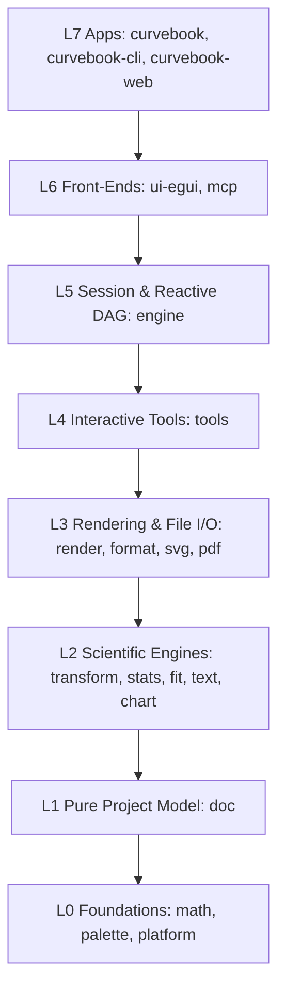

# Architecture

CurveBook is organized as a strictly layered Rust workspace (`L0` through `L7`). `cargo xtask layers` parses `cargo metadata` on every CI run and rejects upward dependencies, undeclared sideways dependencies, `curvebook-testkit` outside `[dev-dependencies]`, external suite crates (`craft-*`), and any UI/windowing crate (`egui`, `eframe`, `winit`, `rfd`, `bevy*`) below `L6`; it also rejects raw process spawning outside `crates/platform/src/`.

## Layers

### L0 — Numerical & Color Foundations
- **`curvebook-math`**: Pure IEEE-754 numerical primitives, compensated summation (Kahan/Neumaier), special functions (`ln_gamma`, regularized incomplete beta $I_x(a,b)$ and gamma $P(a,x)$, `erf`/`erfc`, Student *t*, Snedecor *F*, $\chi^2$, normal CDF/quantile), QR/SVD/Cholesky dense linear algebra for design matrices and Jacobians, and deterministic PRNG helpers for Monte Carlo / permutation tests.
- **`curvebook-palette`** *(may depend on `math`)*: Perceptual color spaces (sRGB, linear RGB, OkLab/OkLCH), print CMYK conversion, colorblind-safe scientific palettes (Okabe–Ito, Viridis, Cividis, Paul Tol), and color-vision-deficiency simulation matrices.
- **`curvebook-platform`**: OS shims kept out of the headless core: atomic temp-file + sync + rename writes (`fs.rs`), bounded subprocesses with cleaned environments (`process.rs`), and `WorkdirGuard` / `PathResolver` path confinement (`path_guard.rs`).

### L1 — Pure Document & Sheet Model
- **`curvebook-doc`**: Immutable/serializable value types representing a CurveBook project:
  - **Data sheets** across the eight experimental table archetypes (`Xy`, `Column`, `Grouped`, `Contingency`, `Survival`, `PartsOfWhole`, `MultipleVariables`, `Nested`), typed cells (numeric `f64`, censored/missing states, excluded-value masks, text/categorical columns with role-inference and level-ordering metadata), replicate subcolumn configurations (`N` raw replicates vs. pre-summarized `Mean + SD/SEM/N` or `Mean + Upper/Lower error`), and provenance-tracked **`LinkedDataRegion`** bindings (internal cross-table links, reactive transpose slices, and external file links).
  - **Info sheets & Floating notes** (structured laboratory metadata, constants hookable into equations/titles, freeform notes, plus collapsible `FloatingNote` callouts attachable to any sheet).
  - **Analysis specs & Result sheets** (parameterized statistical or curve-fitting specifications referencing upstream data/result sheets by stable `SheetId`, auto-derived vs. user-pinned sheet titles, and structured tabular/diagnostic outputs).
  - **Graph specs & Layout specs** (first-visit initialization state, data-series bindings, axis models, error-bar styles, regression curve overlays, pairwise comparison brackets, annotations, and multi-graph + live-table publication page layouts).

### L2 — Scientific Domain Engines
- **`curvebook-transform`**: Data transformations ($Y = \log_{10}(Y)$, Hill/logit/probit transforms, baseline subtraction, `[0, 100%]` normalization, transpose, pruning, and binning) producing derived result tables.
- **`curvebook-stats`**: Parametric and nonparametric hypothesis tests, descriptive statistics, normality/lognormality tests, outlier detection (Grubbs, ROUT), one-/two-/three-way ANOVA, mixed-effects REML, multiple-comparison procedures (Dunnett, Tukey, Šídák, Bonferroni, Holm–Šídák, Benjamini–Hochberg/Krieger–Yekutieli FDR), contingency table analyses, Kaplan–Meier & Cox survival analysis, ROC curves, and multivariate methods (multiple linear/logistic/Poisson regression, PCA).
- **`curvebook-fit`**: Nonlinear and linear least-squares / robust regression engine: damped Levenberg–Marquardt with analytical or forward/central-difference Jacobians, differential weighting ($1/Y$, $1/Y^2$, $1/X$, Poisson), Huber/Cauchy/ROUT biweight robust loss, box/equality/shared global parameter constraints, AICc and extra-sum-of-squares *F* model comparison, replicate test for lack of fit, confidence/prediction bands, and asymptotic vs. profile-likelihood confidence intervals.
- **`curvebook-text`**: Scientific text shaping and measurement (axis tick notation $10^{-6}$, inline superscripts/subscripts, Greek symbols, optional embedded SIL OFL fonts via `CURVEBOOK_FONTS_DIR` gated behind the `bundled-fonts` Cargo feature).
- **`curvebook-chart`** *(may depend on `transform`, `stats`, `fit`, `text`)*: Compiles a `GraphSpec` + resolved upstream `DataSheet`/`ResultSheet` data into a resolution-independent 2D vector scene graph (axes, ticks, discontinuous axis breaks, data series, error bars, box/violin density kernels, fitted curve polylines/Béziers, confidence ribbons, legends, and significance brackets).

### L3 — Rendering & Persistence
- **`curvebook-render`**: Deterministic CPU rasterizer and compositor for compiled chart scenes and multi-panel page layouts (PNG/TIFF exports and golden snapshots). The desktop and web hosts upload this CPU RGBA output as a texture; there is no GPU rendering backend.
- **`curvebook-format`**: Reads and writes the native `.curvebook` and `.cbtemplate` ZIP-based project containers and the unpacked `.curvebook.d/` directory form (versioned manifest + structured JSON/columnar tables, `MIGRATION_STEPS` upgrades), the `ops.journal` crash-recovery journal (`recovery.rs`), and clean-room importers/exporters for CSV, TSV, and third-party `.pzfx` / `.prism` scientific files, all registered in `FormatRegistry` (`registry.rs`).
- **`curvebook-svg`**: Lossless vector SVG serializer for single graphs and multi-panel layouts (preserving editable `<text>` or optional outlined glyphs).
- **`curvebook-pdf`**: Direct PDF 1.7 vector writer for journal submission figures and print layouts.

### L4 — Interactive Tools
- **`curvebook-tools`**: Stateful pointer/keyboard interaction controllers for spreadsheet range selection, data brushing/exclusion, graph object dragging, significance-bracket drawing, axis-break placement, and page-layout alignment guides, plus the `Cursor` catalog verified against `crates/tools/src/cursors.toml`.

### L5 — Engine & Reactive Recalculation
- **`curvebook-engine`**: Owns the live `Session`, undo/redo transaction log, topological dependency graph (`DataSheet -> LinkedDataRegion / Transform / Analysis -> ResultSheet -> Graph -> Layout`), incremental dirty-node invalidation and recalculation, in-place analysis parameter updates and cross-family dataset retargeting (`Change Data Analyzed`), typed workflow services (`curvebook-engine::services`), and the JSON-serializable command dispatcher shared identically by the GUI, CLI, `--control` TCP server, and MCP server.

### L6 — Thin Front-Ends
- **`curvebook-ui-egui`**: Declarative `egui 0.37` desktop shell (`UiApp` session/state host, `egui_shell/*` top chrome, `Navigator`/`Family` dock, multi-mode `CenterStage`, `TrailingDock` inspector/studio, and modal hosts), `UI_COMMANDS` registry (`menus/ui_commands.rs`) with curated 8-menu specification (`menus/menu_bar.rs`), OKLab/OKLCH token palettes and priority-overflow toolbar (`theme.rs`, `egui_shell/top_bar_fit.rs`, governed by [`docs/design-language.md`](design-language.md)), compiled externalized multi-locale `catalog.tsv` + Beta/RTL policy (`i18n.rs`), `egui::accesskit`-projected `ui.inspect` (`inspect.rs`) and semantic action dispatch (`gui_actions.rs`), `--control` TCP framing and host routing (`control_io/host_routing.rs`), pure-Rust CPU tessellation rasterizer and theme specimen renderer (`egui_shell/{rasterizer.rs,specimen.rs}`), and automated human-path/layout geometry verification (`EguiHumanPathDriver`, `WorkflowRun`, `tests/zz_overlap_probe.rs`). Contains zero statistical math; every user intent commits once per settled frame through `curvebook-engine::services`. The legacy manual `LayoutTree` software compositor (`compositor.rs`, `layout/paint.rs`) was retired in `R15.5`.
- **`curvebook-mcp`**: Headless Model Context Protocol server over stdio exposing project inspection, data entry, statistical analysis execution, curve fitting, and SVG/PDF/PNG figure rendering to AI coding and research agents, plus the `gui` toolset (`gui_tools.rs`) that drives `UiApp` in process or over a `--control` TCP session (see [mcp.md](mcp.md)).

### L7 — Executables & Workspace Tooling
- **`apps/curvebook`**: Native desktop binary (`macOS`, `Linux`, `Windows`, `FreeBSD`): `DesktopHostRuntime` (`desktop_host.rs`) owns the `UiApp` session, native host routing, and `--control` lifecycle, while `gui_window.rs` (`run_native_desktop`, `CurveBookNativeApp`) runs stock `eframe`/`egui 0.37` (`wgpu` + AccessKit) with `rfd` native file dialogs and `muda` macOS menus (`R15`).
- **`apps/curvebook-cli`**: Headless batch CLI, format converter, analysis runner, and `mcp` subcommand host (backed by `curvebook-engine::services`).
- **`apps/curvebook-web`**: Browser WebAssembly crate (`wasm32-unknown-unknown`, strict-CSP shell placeholder trimmed in `R15.5`; full `eframe::WebRunner` interactive browser host migration is scheduled post-Beta under [`R11.11`](ROADMAP.md#r1111-migrate-browser-host-to-eframe-webrunner-10-gate)).
- **`xtask`**: Workspace task runner (depends on `curvebook-engine`, `curvebook-format`, `curvebook-testkit`, and `serde_json` for codegen) enforcing formatting, clippy, tests, layer rules, asset attribution, clean-room checks, brand hygiene, telemetry/secrets/licence gates, design-token drift checks, generated-doc sync (`commands`, `schemas`, `ui-commands`, `docs-site`), and macOS `.app` bundling. Run `cargo xtask --help` for the full list.
