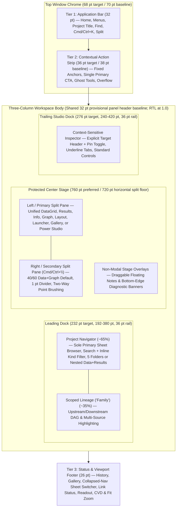

# CurveBook Overall GUI Layout Specification

> **Scope:** Canonical clean-room layout, information-hierarchy, responsive-geometry, and interaction specification for the CurveBook desktop graphical user interface (`apps/curvebook`, `crates/ui-egui`) built under [`R15`](../history/roadmap/r15.md#r15-modern-egui-desktop-gui-overhaul-beta-gate) (**Beta** gate) and refined under [`R20`](../ROADMAP.md#r20-desktop-gui-visual-system--layout-overhaul) (`R20.1`–`R20.4`, non-blocking for **Beta**). In `R15.5`, desktop cutover deletes the legacy `LayoutTree`, `SoftwareTextPainter`, `layout/paint.rs`, `compositor.rs`, and legacy `HumanPathDriver` code immediately without retaining legacy GUI code for `apps/curvebook-web`; browser (`apps/curvebook-web`) `eframe::WebRunner` migration waits strictly until post-Beta [`R11.11`](../ROADMAP.md#r1111-migrate-browser-host-to-eframe-webrunner-10-gate) (**1.0** gate). Statements tagged **`[Target]`** specify planned `R20.2`–`R20.4` refinements alongside **`[Implemented]`** `R15` baseline behaviour.
> **Related Tracked Docs:** [`../design-language.md`](../design-language.md), [`../architecture.md`](../architecture.md), [`../evidence/user-interface.md`](../evidence/user-interface.md), [`../gui-workflows.md`](../gui-workflows.md), [`../localization.md`](../localization.md), [`../ROADMAP.md`](../ROADMAP.md), [`../../AGENTS.md`](../../AGENTS.md).

---

## 1. Purpose, Scope & Architectural Principles

CurveBook is an integrated scientific workbench for structured tabular data entry, data reshaping, statistical inference, parametric and differential-equation curve fitting, and publication-grade figure composition. Its GUI must let researchers move fluidly across five reactive artifact classes—**Data Tables**, **Project Info**, **Analysis Results**, **Graphs**, and **Page Layouts**—without losing lineage context, numerical provenance, or keyboard/pointer ergonomics.

### 1.1 Five Binding Layout Invariants

1. **Headless-First Engine Parity (`L5` <- `L6`):**
   Every document, cell, formula, analysis, fit, graph, or layout mutation initiated by a GUI control commits exclusively through `curvebook_engine::Session::execute` (`Caller::Ui`), preserving exact parity with CLI batch scripts, crash-recovery journals, undo/redo history, and MCP automation. Semantic automation tools (`ui_inspect`, `ui_pointer_gesture`, `ui_type_text`, `ui_press_key`, `ui_invoke_menu`, `ui_switch_tab`, `ui_answer_dialog`, `ui_screenshot`) drive the identical interactive widget tree used by a human operator.
2. **Single Retained Layout Source (`egui` + AccessKit + `FrameInspectMeta`):**
   All chrome regions, scrollable viewports, hit boxes, clip rectangles, focus rings, and accessibility roles derive from a single settled stock `egui 0.37` layout pass (`!ctx.will_discard()`) paired with `egui` AccessKit output and a thin `FrameInspectMeta` side-table, plus a pure-Rust CPU `egui` tessellation rasterizer for GPU-less CI screenshots, so rendered pixels, pointer hit-testing, and desktop accessibility nodes never diverge (`verify_pixel_to_hit_box_parity`). Legacy `LayoutTree` is deleted on desktop cutover (`R15.5`); browser `eframe::WebRunner` adoption awaits post-Beta [`R11.11`](../ROADMAP.md#r1111-migrate-browser-host-to-eframe-webrunner-10-gate) (**1.0**).
3. **Modeless Inspection First, Deep Modals on Escalation:**
   Everyday exploration—changing symbol encodings, rescaling axes, editing column formulas, inspecting assumption checklists, or drilling from an outlier point back to its source row—happens live inside the **Trailing Inspector & Studio Dock** with immediate undoable canvas/grid feedback. Multi-tab modal dialogs (`Edit Analysis Parameters`, `Format Graph`, `Format Axes`, `Import & Paste Special`) handle multi-property batch configuration with explicit `Apply` (non-closing preview), `Cancel`, and primary commit actions.
4. **Surface-First Single Theme, Single-Owner Navigation & Attributed Reuse:**
   CurveBook uses an original two-tier scientific header (`Application Bar` + single-row `Contextual Action Strip`), single-owner `Project Navigator` sheet browsing, a native split-comparison center stage with an explicit three-way targeting contract (§2.4), and a unified context-sensitive right-hand studio rail—built from one canonical theme and widget module ([`../design-language.md`](../design-language.md)) using three opaque neutral surface tiers rather than repeated widget outlines. Permissively licensed pure-`egui` widget helpers and AccessKit/top-bar utilities adapted under [`../../AGENTS.md`](../../AGENTS.md) follow the attribution requirements in [`../../ATTRIBUTION.md`](../../ATTRIBUTION.md) and [`../../NOTICE`](../../NOTICE) while retaining CurveBook's own terminology, layout proportions, original vector iconography ([`../../ASSETS.md`](../../ASSETS.md)), and color tokens.
5. **Zero-Crash, Zero-Telemetry, Multilingual & HiDPI-Exact Geometry:**
   Every layout calculation uses saturating/checked arithmetic down to degenerate `0×0` and `64×64` viewports without panicking; scales cleanly across `1.0x`–`4.0x` HiDPI factors; enforces text fitting across all `14` Beta-active LTR/CJK locales (with the `4` RTL locales `ar`, `fa`, `he`, `ur` and horizontal RTL mirroring gated on **1.0** and mapped cleanly to `"en"` on saved Beta `preferences.json` files while keeping mathematical coordinate axes and formulas left-to-right); and never initiates network egress.

---

## 2. Global Window Shell & Spatial Partitioning

### 2.1 Canonical Shell Anatomy (LTR Orientation)

```text
+-----------------------------------------------------------------------------------------------------------------+
| [Home] [File Edit View Insert Data Analyze Graph Help]                     [Project] [Find...] [Cmd+K] [Split]  |  32 pt  Tier 1: Application Bar
+-----------------------------------------------------------------------------------------------------------------+
| [+ Sheet v] [Undo Redo] | [Primary CTA: Analyze... / Graph Type...]  Ghost Quick Tools                    [...] |  36 pt* Tier 2: Action Strip (no sheet tabs)
+-----------------------+-----------------------------------------------+-----------------------------------------+
| Project Navigator [<<]| [Dose-Response v]      | [4PL Curve Fit v] [x]| Graph Inspector · 4PL Fit     [Pin][>>] |  32 pt* Shared Panel Header Baseline
|-----------------------+------------------------+----------------------+-----------------------------------------+
| [Search...] [All v]   |   #  | X     | Y1 | Y2 |                      | Data  Axes  Legend  Annotations  Canvas |
| > Data Tables         |   1  | 0.01  |98.4|97.1|   Live Graph Sheet   | ────                                    |
|   Dose-Response       |   2  | 0.10  |97.9|98.1|  (Fit Zoom Active)   |  [x] Data points                        |
|   + New Data Table... |   3  | 1.00  |74.5|71.0|                      |  [x] Fitted curve overlay               |
| > Info                |                        |  Draggable 40/60     |                                         |
| > Results             |   Unified Virtualized  |  Split (1 pt divider,|  Series: (●) Compound 7                 |
| > Graphs              |       DataGrid         |  8 pt hit slop)      |  Shape:  [ ○ | □ | △ | ◇ ]              |
| > Layouts             |  (Contiguous Hairlines)|                      |                                         |
|-----------------------|                        |                      |                                         |
| Family (Lineage)      |   + [Floating Notes]   | + [Bottom Banner]    |  [Format Graph...]                      |
|   Dose-Response       |                        |                      |  [Apply Style From...]                  |
|     4PL Curve Fit     |                        |                      |                                         |
+-----------------------+------------------------+----------------------+-----------------------------------------+
| [< >] [Gallery] [Sheet v*] [Link OK] | Quick-Stats / Canvas Size               | [CVD] [- Fit v +]              |  26 pt  Tier 3: Status Footer
+-----------------------------------------------------------------------------------------------------------------+
   232 pt* (192-380 pt)              Protected Flexible Center Stage                  276 pt* (240-420 pt)
   * [Target] provisional R20.2-R20.4 metrics (Sheet v shown in Footer only when Navigator is collapsed)
```



### 2.2 Deterministic Z-Layer Stack (`ZLayer`)

Every painted primitive and interactive hit region belongs to a strict z-order plane so popups and modals never suffer click-through or overlapping hit ambiguity:

| Ordinal | `ZLayer` | Contents & Pointer Capture Rules |
|---:|---|---|
| `0` | `Workspace` | Docked panels (`AppBar`, `ActionStrip`, `Navigator`, `Family`, `CenterStage`, `TrailingDock`, `StatusBar`), virtualized contiguous grid cells, chart scenes, and scrollbars. |
| `10` | `FloatingOverlay` | Sheet-anchored `FloatingNote` cards, non-blocking bottom canvas diagnostic banners, linked-region hover badges, and transient `2 pt` keyboard focus / `F6` landmark cues (`[Target]`: never a permanent full-pane blue border cage over blank canvas or table whitespace). |
| `20` | `SplitHandle` | Draggable resize dividers (`Navigator/Center`, `Navigator/Family`, `Left/Right` center split, `Center/Inspector`, and column-header resize grips). |
| `30` | `DropdownMenu` | Top menu bar popups, pane sheet selectors, compact kind filter, action-strip overflow menu (`⋯`), and workspace combobox lists. |
| `40` | `ModalBackdrop` | Dimmed translucent full-window scrim (`rgba(15, 23, 42, 128)`). Captures **100%** of outside pointer clicks and wheel events when any modal is active. |
| `50` | `ModalDialog` | Active modal dialog window, `Cmd/Ctrl+K` Command Palette, or nested detail sub-modal (`Additional Ticks & Reference Lines`, `Clone Pipeline Options`). |
| `60` | `ModalDropdown` | Combobox/dropdown popups, color-swatch popovers, and constant-hook pickers opened *inside* an active modal dialog. |
| `70` | `ContextMenu` | Right-click context menus (grid cells, column headers, navigator items, plotted graph marks/bars, layout panels, linked data regions). |
| `80` | `Tooltip` | Non-interactive hover tooltips (disabled-predicate `disabled_reason` explanations, excluded-cell provenance, plotted-point data readouts, colorbar value readouts, shortcut hints). |

### 2.3 Responsive Viewport Breakpoints & Collapse Priority

Minimum supported desktop window size is **`640 × 420 pt`** (default **`1280 × 800 pt`**); headless/embedded viewports remain panic-free down to `0 × 0 px`.

| Breakpoint | Logical Width (`pt`) | Layout Behavior & Deterministic Auto-Collapse Order |
|---|---|---|
| **Wide Desktop** | `>= 1440 pt` | Both `Navigator` (`232 pt` `[Target]` / `240 pt` `[Implemented]`) and `TrailingDock` (`276–310 pt`) open comfortably alongside a wide `CenterStage` (`>= 900 pt`), giving horizontal Split Comparison full breathing room. `AppBar` shows the inline search/find capsule and `Cmd/Ctrl+K` button. |
| **Standard Laptop** | `960 – 1439 pt` | In single-sheet mode, `Navigator` (`192–232 pt`), `CenterStage` (`>= 480 pt`), and `TrailingDock` (`240–276 pt`) stay visible simultaneously; `ActionStrip` sheds `Overflow` then `Secondary` actions into `⋯` via `fit_ranked_toolbar`. In Split Comparison, the usable-width cascade below governs dock narrowing and collapse. |
| **Compact / Tablet** | `640 – 959 pt` | Auto-collapses in strict priority order to preserve `>= 360 pt` for `CenterStage`: (1) `AppBar` search/find condenses to icons; (2) `TrailingDock` collapses into a `36 pt` vertical rail (opening as an overlay flyout when explicitly expanded); (3) if `< 760 pt`, `Navigator` collapses into a `36 pt` leading rail (overlay flyout when expanded); (4) Split Comparison follows the narrow-viewport cascade below. |

#### Split-Comparison Usable-Width & Narrow-Viewport Degradation Cascade (`[Target]`)

Split Comparison computes all thresholds against the **settled logical center area** (the logical `pt` width and height remaining inside `CenterStage` after OS display scaling and CurveBook `ui_scale` have already been applied once by `egui`). Increased text scale (`ui_scale > 1.0`) therefore shrinks logical viewport dimensions naturally and flows through the identical deterministic cascade—always preserving both materialized split IDs (`primary_sheet_id`, `secondary_sheet_id`) so widening restores the split pair intact:

- **Preferred horizontal split width (`split_center_preferred_w`):** **`760 pt`** *(provisional target, validated empirically at default and `ui_scale > 1.0`)* with a draggable **`40/60`** initial ratio for `Data + Graph` (`50/50` for symmetric sheet pairs).
- **Hard horizontal split floor (`split_center_min_horizontal_w`):** **`720 pt`**. Widths inside the **`720–759 pt` compact horizontal band** are explicitly accepted as horizontal when docks have already narrowed to their minimums or remain user-expanded.

Deterministic degradation order whenever Split Comparison is active:

1. **Narrow docks first:** if settled logical center width would fall below `760 pt`, narrow Leading Navigator (`232 -> 192 pt`) and Trailing Studio (`276 -> 240 pt`) proportionally before collapsing either dock.
2. **Collapse Trailing Studio (unless user-expanded):** if settled logical center width still falls below `760 pt`, collapse Trailing Studio to its `36 pt` rail—unless the user explicitly expanded it during the current split session, in which case it stays open (rendering as an overlay flyout in Compact `< 960 pt` windows) and the remaining center width recalculates.
3. **Collapse Leading Navigator (unless user-expanded):** if settled logical center width still falls below `760 pt`, collapse Leading Navigator to its `36 pt` rail (with the same overlay-flyout rule if user-expanded in Compact `< 960 pt` windows; the Bottom Footer exposes a compact Active Sheet Switcher whenever Navigator is collapsed).
4. **Vertical split (`< 720 pt` width, `>= 520 pt` height):** whenever settled logical center width drops below the **`720 pt` hard floor**—whether from a narrow window, user-expanded docks, or `ui_scale > 1.0`—and settled logical center height is `>= 520 pt`, switch Split Comparison automatically from Horizontal (`Left || Right`) to Vertical (`Top / Bottom`).
5. **Single-pane compact flip fallback (`< 720 pt` width AND `< 520 pt` height, e.g., `640 × 420 pt` or high `ui_scale`):** when neither horizontal nor vertical split can give both panes usable room, temporarily show one split pane at a time with a compact segmented pane-flip control in the shared `32 pt` pane header (`[Dose-Response Assay | 4PL Curve Fit]`), keeping both materialized split IDs intact until usable space returns. **Invariant:** in this mode the visible pane always holds `doc.active_sheet_id`. Any action that makes the hidden split sheet the command target (a `Project Navigator` or footer sheet-switcher selection) also flips to that pane, so the visible sheet and the Tier 2 toolbar target never differ.

### 2.4 Keyboard Focus Cycling & RTL Mirroring

#### Three-Way Split-View Targeting & Keyboard Focus Contract (`[Target]`)

To prevent split-pane focus, Navigator selection, and Inspector controls from fighting over one implicit sheet ID—and to retire the button-based split preview fallback—Split Comparison separates **three independent states** with explicit persistence and command boundaries:

1. **Contextual Command Target = Persisted `doc.active_sheet_id`:**
   - The contextual command target **is** `ProjectDocument::active_sheet_id` (`crates/doc/src/project.rs`), persisted in `.curvebook` / `.prism` archives and updated solely through `curvebook-engine` (`sheet.select`).
   - **Preserved `sheet.select` semantics:** `sheet.select` is registered with `Effects::CHANGES_UI_STATE | Effects::IDEMPOTENT` (not `MUTATES_DOCUMENT`) and returns `CommandOutcome::read_only(...)`, so changing the active command target **never creates an undo step, never marks the session dirty, and never appends to `ops.journal`**.
   - **Family-anchor preservation:** Selecting a sheet in `Project Navigator` calls `sheet.select` with default `mode: "navigator"` (updating both `active_sheet_id` and `family_anchor_sheet_id`). **Activating a split pane or switching panes in compact fallback calls `sheet.select` with `mode: "family"`**, updating `doc.active_sheet_id` while **preserving `family_anchor_sheet_id`** so editing cells in a split table does not re-anchor or churn the Family lineage tree.
   - Drives Tier 2 contextual actions (`Analyze…`, `Graph Type…`, `Export…`) and Navigator/Family active-row selection.
2. **Pane Display Assignment (`primary_sheet_id`, `secondary_sheet_id` — Ephemeral UI View State):**
   - Materialized as concrete `SheetId`s inside `SplitWorkspaceState` the instant Split Comparison opens; never left `None` to drift with `doc.active_sheet_id` (falling back only if an assigned sheet is deleted) and never persisted to `ProjectDocument` or `ops.journal`.
   - Both panes instantiate full native renderers parameterized by explicit `sheet_id`—including the unified virtualized `DataGrid` with independent per-pane scroll and cell-selection state—**retiring `render_split_non_column_preview` and `render_split_column_sheet_preview`**.
3. **Keyboard Focus (`focused_pane`, focused widget/cell) & Inspector Target + Pin (`inspector_target_sheet_id`, `inspector_pinned` — Ephemeral UI View State):**
   - Strictly ephemeral UI view state (never persisted or journaled).
   - **Keyboard Focus** controls solely where typing, arrow keys, `Tab`, `Enter`, and `F6` route. Indicated by a `2 pt` `focus_ring` on the active widget or grid cell, a quiet `2 pt` top accent bar on the focused split-pane header, and a transient `2 pt` landmark cue during `F6` traversal—never a permanent full-pane blue cage over blank whitespace.
   - **Inspector Target, Auto-Pin Default & Pin Lifecycle:** When `inspector_pinned == false`, `inspector_target_sheet_id` follows `doc.active_sheet_id`. **Opening the `Data + Graph` split preset automatically sets `inspector_target_sheet_id` to the graph sheet and sets `inspector_pinned = true`**, showing the explicit target title and an interactive `Pinned` toggle in the Trailing Studio header (e.g., `Graph Inspector · 4PL Curve Fit [Pinned]`). Thus editing a split table cell, watching the fitted curve refit, and adjusting graph settings works immediately with **zero manual pinning**. *(Auto-pin applies only to the `Data + Graph` preset. The other shipped presets, `Data + Results` and `2-Up (50 / 50)`, open unpinned, with the Inspector following `doc.active_sheet_id`.)* **Pin invalidation:** whenever the pinned sheet leaves the displayed split pair (via pane selector or Navigator replacement), is deleted (`sheet.delete`), or Split Comparison closes (`ui.split.toggle { enabled: false }`), `inspector_pinned` resets automatically to `false` and `inspector_target_sheet_id` falls back to `doc.active_sheet_id`.
   - **UI Call-Site Explicit `sheet_id` Audit Mandate:** Engine commands (`graph.setSpec`, `graph.setSeries`, `graph.setAxes`, `table.setCell`, etc.) already require `sheet_id`. Every Trailing Studio Inspector UI call site in `crates/ui-egui` MUST fill `sheet_id` from `inspector_target_sheet_id`, and every split `DataGrid` UI call site MUST fill `sheet_id` from its own pane's materialized `SheetId`—never implicitly reading `doc.active_sheet_id`.
   - **Document-Scoped vs. Sheet-Local Shortcuts:** Project-wide `Undo` / `Redo` (`edit.undo` / `edit.redo` in `crates/engine/src/lib.rs`) remain document-scoped across the session and are never treated as sheet-local grid shortcuts. Sheet-local grid shortcuts (`Enter`, `Tab`, arrows, `Copy`/`Paste`, `Exclude`, `Delete`) target the focused pane's explicit `sheet_id`.

| User Action | Pane Display (`primary_sheet_id`, `secondary_sheet_id`) | Keyboard Focus (`focused_pane` / widget) | Command Target (`doc.active_sheet_id`) | Inspector Target (`inspector_target_sheet_id`, `inspector_pinned`) |
|---|---|---|---|---|
| **Click or edit a cell in a split `DataGrid`** | Unchanged | Moves to clicked cell; inline edits & sheet-local grid shortcuts commit using this pane's explicit `sheet_id` | **Updates** to this pane's `DataSheet` via non-mutating `sheet.select { mode: "family" }` (Tier 2 table actions update; Family anchor preserved) | If `inspector_pinned == true` (default on `Data + Graph`), **stays on pinned target** with visible target title/pin; if unpinned, follows `doc.active_sheet_id` |
| **Click into a split `GraphSheet` / `LayoutSheet` canvas** | Unchanged | Moves to clicked canvas / mark | **Updates** to this pane's sheet via `sheet.select { mode: "family" }` (Family anchor preserved) | If unpinned, follows `doc.active_sheet_id`; if pinned to another sheet, stays pinned and shows a one-click `Switch to <Sheet>` chip |
| **Press `F6` / `Shift+F6`** | Unchanged | Cycles visible landmarks only (`Navigator -> Family -> Left Pane -> Right Pane -> Floating Notes -> Trailing Studio`; in the compact single-pane flip, only the visible pane is a stop) with transient `2 pt` cue | **Unchanged** | **Unchanged** |
| **Select a sheet in `Project Navigator` (or the footer sheet switcher)** | If already displayed in either split pane: **unchanged** (in the compact single-pane flip, that pane also becomes the visible pane). Otherwise: replaces the explicit `SheetId` of the pane holding the previous `doc.active_sheet_id` (falling back to last focused split pane, then Primary) | Stays in Navigator for arrow browsing (moves into pane on `Enter` or pane click) | **Updates** to selected sheet via `sheet.select { mode: "navigator" }` (re-anchors Family as today) | If unpinned, follows selected sheet. If pinned and pinned sheet stays in the sibling pane, stays pinned (showing `Switch to <Sheet>`). If the replaced pane held the pinned sheet, **unpins (`false`)** and follows selected sheet |
| **Click a control in `Trailing Studio` Inspector** | Unchanged | Moves to clicked Inspector control | **Unchanged** (every Inspector call site passes explicit `inspector_target_sheet_id`) | **Unchanged** (header displays `inspector_target_sheet_id`) |
| **Change a pane's header sheet selector** | Updates that pane's explicit `SheetId` | Stays in the interacted pane | Updates to the newly assigned sheet via `sheet.select { mode: "family" }` if that pane previously held `doc.active_sheet_id` | Follows if unpinned; if the pinned sheet left the split pair, **unpins (`false`)** and follows `doc.active_sheet_id` |
| **Click `Swap` (widget `split.swap`; dispatches `ui.split.toggle` with `primary_sheet_id` and `secondary_sheet_id` exchanged, no separate swap command is registered)** | Exchanges pane positions (`primary_sheet_id <-> secondary_sheet_id`) | Moves with the previously focused sheet (or stays on the interacted pane header) | **Unchanged** (stays attached to its sheet regardless of left/right position) | **Unchanged** (both `inspector_target_sheet_id` and `inspector_pinned` stay attached to their sheet) |
| **Switch visible pane in Compact `< 720 × 520 pt` flip (`[Sheet A \| Sheet B]`)** | Preserves both materialized split IDs while switching which pane is displayed | Moves to newly visible pane | **Updates** to the newly visible sheet via `sheet.select { mode: "family" }` (keeping visible pane and Tier 2 toolbar in sync; Family anchor preserved) | **Preserves `inspector_pinned`** and `inspector_target_sheet_id` while both sheets remain in the active split pair; if unpinned, follows `doc.active_sheet_id` |
| **Delete pinned sheet (`sheet.delete`) or close Split Comparison** | Clears deleted ID (falling back to surviving sheet) or exits split to `doc.active_sheet_id` | Moves to surviving active pane | Resolves via engine to surviving `doc.active_sheet_id` | **Unpins (`false`)** and resets `inspector_target_sheet_id` to `doc.active_sheet_id` |

#### Landmark Focus Order & RTL Mirroring

- **Pane Focus Traversal (`F6` / `Shift+F6`):** Cycles keyboard focus across visible top-level scopes in deterministic order:
  `Navigator` -> `Family` (if open) -> `Left / Primary Pane` -> `Right / Secondary Pane` (if split active and visible; the compact single-pane flip exposes only its visible pane) -> `Floating Notes` (if present) -> `Trailing Studio Dock` (if open). The active landmark renders a transient `2 pt` `focus_ring` cue during keyboard traversal.
- **RTL Locale Mirroring (`1.0` gate — `ar`, `fa`, `he`, `ur` hidden at Beta with `"en"` fallback in `preferences.json`):**
  - Horizontal panel docking mirrors cleanly (`Navigator` docks right, `TrailingDock` docks left, `AppBar` menus start right, `StatusBar` zoom moves left, disclosure triangles and history arrows flip).
  - **Scientific invariance in RTL:** Numeric digits, mathematical expressions (`f(x) = ...`), $\TeX$ equations, and standard Cartesian `X` axes remain left-to-right unless an explicit axis-reversal property is toggled by the user.

---

## 3. Top Chrome: Application Bar & Contextual Action Strip

### 3.1 Tier 1 — Application & Document Bar (`32 pt`)

- **Leading Cluster:**
  - Platform window caption clearance on macOS transparent titlebars (with double-click-to-zoom drag area on empty bar space).
  - **Home / Launcher Button** (`20 × 20 pt`, hit box `28 × 28 pt`): Toggles the Project Launcher / Template Hub without closing the current project.
  - **Menu Bar:** Routed to the native macOS menu bar via macOS-only `muda` (`cfg(target_os = "macos")`, `default-features = false`) while keeping the in-`egui` `MenuBar` active on Windows/Linux/FreeBSD, under `--in-window-menus`, and across `EguiHumanPathDriver`/`egui_kittest` runs with an automated `command_id`/enablement parity test:
    `File` · `Edit` · `View` · `Insert` · `Data` · `Analyze` · `Graph` · `Help`.
- **Middle Cluster — Active Project Header / Optional Multi-Project Tabs:**
  - In **Beta**, renders the active project header and unsaved dirty-state indicator (`•`) for `apps/curvebook`'s single-session window; multi-project in-window document tabs (`.curvebook` tab strip, `+` new project, OS window drag-out, and `Window › Consolidate / Tile`) are deferred post-1.0.
- **Trailing Cluster (Right-to-Left Fit Solver):**
  - **`[Implemented]` Inline Find Capsule (`Cmd/Ctrl+F`) & Command Palette (`Cmd/Ctrl+K`):** Displays an inline search/find capsule when room permits (`>= 180 pt`), degrading cleanly to icon buttons in narrow windows; disabled while a modal dialog owns focus.
  - **Split-Workspace Quick Toggle (`Cmd/Ctrl+\`):** One-click toggle and preset menu (`Off`, `Data + Graph`, `Swap Panes`, and orientation options). **`[Target]`** Active split state renders via a subtle recessed pill or active icon tint—never appending `•` (reserved exclusively for unsaved dirty state).
  - **`[Implemented]` Workspace Presets under `View`:** Workspace layout presets (`Default`, `Data Prep`, `Modeling`, `Publication`, `Compact`) live in the `View` menu rather than competing for horizontal space in Tier 1.

### 3.2 Tier 2 — Sheet-Adaptive Contextual Action Strip (`38 pt`)

A single uncluttered horizontal strip (`38 pt` `[Implemented]`; **`36 pt` `[Target]` provisional height**) divided by subtle `1 pt` `divider` rules into semantic groups. **`[Target]` Single-owner navigation:** Tier 2 never renders duplicate open-sheet tabs (`sheet.tab.*` retired in `R20.3`; `Project Navigator` is the sole primary sheet browser). Secondary actions render as borderless **Ghost Actions** at rest on `surface_chrome` (highlighting with `hover_bg` on hover), keeping at most one accent **Primary** CTA per context and spilling lower-priority controls into `⋯` via `fit_ranked_toolbar`. Universal left-hand anchors stay in fixed positions across sheet switches so muscle memory never breaks; right-hand groups adapt to `doc.active_sheet_id`'s sheet kind and table archetype:

| Active Context | Fixed Leading Anchors | Primary Contextual CTA Group | Secondary Contextual Tools | Trailing Output & View Group |
|---|---|---|---|---|
| **`EmptyWorkspace` / Launcher** | `New Project`, `Open…` | `New Data Table…`, `Browse Samples`, `Clone Pipeline…` | `Import CSV / TSV…`, `Power & Sample Size…` | `Theme`, `Language` |
| **`DataSheet` (Structured)** | `+ New Sheet v`, `Undo`, `Redo`, `Cut/Copy/Paste`, `Paste Link` | **`Analyze…`** (accent button) + **Archetype Quick-Run Actions** (e.g., `t-Test` / `ANOVA` on Column; `Fit Curve` / `Linear Reg.` on XY; `2-Way ANOVA` on Grouped; `Contingency` on Contingency; `Kaplan-Meier` on Survival) | `Import / Reshape…`, `Transform…`, `Exclude (Cmd+E)`, `Freeze Table`, `Sort / Prune`, `Decimals (.00)` | `New Graph`, `Inspector`, `⋯` |
| **`DataSheet` (`MultipleVariables`)** | `+ New Sheet v`, `Undo`, `Redo`, `Cut/Copy/Paste`, `Paste Link` | **`Analyze…`** (accent button) + **`+ Calculated Variable (fx)`** + **Quick-Run Actions** (`Linear/GLM`, `PCA`, `Cluster`, `MV Plot`) | `Manage Variables…`, `Filter & Transform…`, `Extract & Rearrange…`, `Exclude (Cmd+E)`, `Freeze Table` | `New MV Graph`, `Formula Studio`, `⋯` |
| **`InfoSheet`** | `+ New Sheet v`, `Undo`, `Redo`, `Copy/Paste` | **`+ Add Constant`** | `Add Date/ID Preset`, `Link Constant…`, `Format Notes` (`Bold`, `Italic`, `List`) | `Inspector`, `⋯` |
| **`ResultSheet`** | `+ New Sheet v`, `Undo`, `Redo`, `Copy`, `Copy Methods` | **`Edit Parameters… (Cmd+T)`** (accent button) + **`Interpret & Checklist`** (badge shows warning count) | `Change Data Analyzed…`, `Chain Analysis…`, `New Graph from Tab…` | `Export Table…`, `Inspector`, `⋯` |
| **`GraphSheet`** | `+ New Sheet v`, `Undo`, `Redo`, `Copy Vector` | **`Graph Type…`** + **`Analyze / Fit…`** | `Format Graph…`, `Format Axes…`, `Pairwise / CLD v`, `Insert Text / TeX / Bracket v`, `Palette` | **`Export Figure…`**, `Print…`, `Inspector`, `⋯` |
| **`LayoutSheet`** | `+ New Sheet v`, `Undo`, `Redo`, `Copy Vector` | **`+ Place Graph`** + **`Arrange Grid…`** | `Align / Distribute v`, `Sync Panel Scales` *(1.0 `R13.5`)*, `Panel Badges (A, B, C)`, `Add Text / TeX / Scale Bar` | **`Export Layout…`**, `Print…`, `Inspector`, `⋯` |

---

## 4. Leading Dock: Project Navigator & Scoped Lineage ("Family")

### 4.1 Upper Pane — Project Navigator (`~65%` height, resizable)

`Project Navigator` is the **sole primary sheet browser** (`232 pt` `[Target]` default width, min `192 pt`; `240 pt` `[Implemented]`).

1. **Shared Panel Header (`32 pt` provisional `[Target]`):** Aligns horizontally on the same baseline, padding, and `1 pt` bottom `divider` rule as Center Split pane headers and Trailing Studio, with a crisp `1.5 pt`-stroke vector sidebar-collapse button.
2. **Search & Compact Kind Filter (`[Target]`):** Directly below the header sits the bordered substring search input (`navigator.search_input`) with clear (`×`) button paired inline with a single compact **Kind Filter dropdown** (`All`, `Data`, `Info`, `Results`, `Graphs`, `Layouts`), replacing the stacked 2×3 bordered filter-chip block.
3. **Two Organization Modes (toggled via Navigator header menu or `Preferences › Workspace`):**
   - **Five-Folder Category Mode (Default):** Collapsible top-level sections:
     1. `Data Tables`
     2. `Info`
     3. `Results`
     4. `Graphs`
     5. `Layouts`
   - **Nested Pipeline Mode (`Data with Results`):** Folds each derived `ResultSheet` directly underneath its upstream `DataSheet` as an expandable child tree (matching natural experimental notebook hierarchy), while keeping `Info`, `Graphs`, and `Layouts` as sibling sections.
4. **Row Anatomy (`26 pt` height, `>= 24 pt` hit box, scrollbar never overlaps right-edge badges):**
   - **`[Target]` Vector disclosure triangles & frameless sheet icons:** Crisp `1.5 pt`-stroke disclosure triangles (pointing inward collapsed, downward expanded—never dot-like Unicode bullets) + frameless semantic sheet-kind icons (never checkbox-like checkmark-in-box or slash-in-box frames) + editable sheet title + trailing status badges (`Frozen` lock badge, `Color Tag` dot, `Warning/Unconverged` indicator).
   - Active selection uses `active_bg` when Navigator holds focus and neutral `selection_unemphasized_bg` when focus lives in another pane (`[Target]`).
   - Clicking a section header's **`Folder Gallery`** icon switches the Center Stage into the Multi-Sheet Thumbnail Gallery filtered to that section.
   - Each section ends with a **neutral muted** inline **`+ New <Kind>…`** row (`text_muted` at rest, `text_strong` on hover—never accent blue) for zero-menu sheet creation.
5. **Direct Manipulation & Cascading Integrity:**
   - **Double-click title (`F2`):** Inline rename (`sheet.rename`), automatically cascading updated titles to dependent default analysis headers, graph titles, and legend labels.
   - **Drag-reorder within section:** Reorders sheets deterministically without mutating stable `SheetId`s.
   - **Drag an Analysis (`ResultSheet`) onto another compatible `DataSheet`:** Opens the `Retarget Analysis` confirmation preview and rebinds the entire downstream analysis + graph lineage to the target data table.

### 4.2 Lower Pane — Scoped Lineage ("Family") Tree (`~35%` height, `Cmd/Ctrl+Shift+F`)

Separated from the Project Navigator by a `1 pt` `divider` centered inside a `4 pt` (`8 pt` hit-slop) splitter:
- Displays **only** the connected topological subgraph of the current Family anchor (`doc.family_anchor_sheet_id`):
  `Root Data Table(s)` -> indented `Chained Transforms / Analyses` -> `Derived Graphs` -> `Referencing Page Layouts`.
- Selecting a sheet in `Project Navigator` re-anchors `Family` (`sheet.select { mode: "navigator" }`); activating a pane inside Split Comparison updates `doc.active_sheet_id` while **preserving `family_anchor_sheet_id`** (`sheet.select { mode: "family" }`, §2.4).
- **Active-Node & Multi-Dependency Highlighting:**
  - The active command target (`doc.active_sheet_id`) renders with emphasized (`active_bg`) or unemphasized (`selection_unemphasized_bg`) selection depending on focus.
  - When a **Composite `LayoutSheet`** or **Multi-Dataset `GraphSheet`** is selected, *all* upstream Data Tables, Analyses, and Graphs contributing panels or curves to that sheet are highlighted in **bold** in both `Family` and `Project Navigator`, pairing a clear multi-source badge (e.g., `2 sources` with a tooltip listing upstream tables—replacing opaque abbreviations such as `"2+src"`, `[Target]`).
- **Hover Quick-Preview:** Hovering an inactive node in `Family` for `>= 450 ms` displays a compact read-only summary tooltip (table dimensions/archetype, test name + primary $P$-value, or thumbnail aspect preview).

---

## 5. Center Stage: Multi-Mode Viewport, Split Comparison & Stage Overlays

The Center Stage is a protected dock target (cannot be closed or floated away) that operates in one of five mutually exclusive primary modes:

1. **Single-Sheet Mode (Default):** Full central area renders the active `DataSheet`, `InfoSheet`, `ResultSheet`, `GraphSheet`, or `LayoutSheet`.
2. **Split-Comparison Mode (`Cmd/Ctrl+\`):**
   - **`[Target]` Materialized Pane IDs & `40/60` Default:** Divides the Center Stage into two explicitly assigned panes (`primary_sheet_id`, `secondary_sheet_id`, §2.4) separated by a `1 pt` `divider` line inside a `4 pt` (`8 pt` hit-slop) draggable splitter (`15%`–`85%` clamp; **`40/60`** default ratio for `Data + Graph`, `50/50` for symmetric pairs; double-click resets to the preset default).
   - **`[Target]` Shared `32 pt` (Provisional) Pane Header Strip:** Aligns flush with `Project Navigator` and `Trailing Studio` on the shared header baseline. Each pane's **frameless sheet icon + sheet-selector dropdown IS the pane title**—dropping redundant `"Primary"` / `"Secondary"` labels and the duplicate sub-header bar—paired with borderless ghost `Swap` and `Close` actions (or the compact `[Sheet A | Sheet B]` pane-flip switcher when `< 720 × 520 pt` per §2.3).
   - **`[Target]` Quiet Active-Pane Focus Cue:** The pane owning keyboard focus displays a `2 pt` top accent bar along its header strip (retiring the permanent `2 pt` full-pane blue cage around blank whitespace).
   - **`[Target]` Unified Native Renderers (Zero Preview-Grid Fallback):** Both panes instantiate the real sheet renderer parameterized by explicit `sheet_id`—including the virtualized contiguous `DataGrid` (§8.2) with independent per-pane scroll and selection state—**retiring `render_split_non_column_preview` and `render_split_column_sheet_preview`**.
   - **Live Two-Way Point Brushing:** Selecting or hovering rows in a Data/Residual Grid highlights the corresponding plotted marks/bars on an adjacent `GraphSheet`, and box-selecting or clicking plotted marks on a `GraphSheet` scrolls to and highlights the originating cells in the adjacent `DataSheet`.
3. **Multi-Sheet Portfolio Gallery Mode:**
   - Activated by clicking a Navigator folder gallery icon, the `Gallery` footer button (`ui.gallery.toggle`), or `View › Sheet Gallery`.
   - Renders a responsive grid of live-rendered sheet preview cards with folder filter chips (`All`, `Graphs`, `Layouts`, `Data`, `Results`), thumbnail zoom slider, `F6` pane cycling, and click-to-open. Multi-card selection checkboxes (`Shift+Click` range, `Cmd/Ctrl+Click` multi-select) and batch cloning actions (`Apply Style From…`, `Export Selected…`, `Place Selected onto New Layout`) plug into this view on the **1.0** gate (`R13.3`).
4. **Project Launcher Mode:** Shown automatically when `total_sheet_count() == 0` or when `Home` / `File › New Data Table…` is invoked in full-stage mode (see §8.1).
5. **Prospective Power & Sample Size Studio Mode:** Full-stage or large-modal interactive study-planning workflow (see §8.13).

### 5.1 Stage-Level Non-Modal Overlays (`ZLayer::FloatingOverlay`)

- **Floating Callout Notes (`FloatingNote`):**
  - Draggable, collapsible cards pinned to a specific sheet in logical coordinates (`note_positions_pt`), with color-coded header band (neutral slate, amber note, sky info, emerald checklist), crisp vector collapse triangle, and inline rich-text body; clamped so headers never escape the visible viewport or block split-pane dividers.
- **Non-Blocking Bottom-Edge Diagnostic & Clipping Banner (`28–36 pt`):**
  - Docked flush along the bottom inside edge of a `GraphSheet` or `ResultSheet` viewport whenever data-visibility caveats exist:
    - *Unplotted Missing Rows:* `"4 rows with missing values in mapped variables were omitted from this plot. [Show Rows] [Dismiss]"`
    - *Clipped Error Bars / Confidence Bands:* `"Manual axis range clips 2 error bars or confidence-band segments. [Why?] [Fit Range]"`
    - *Read-Only Linked Region Guard (on `DataSheet`):* `"Cells B1:D12 are live-linked to 'Raw Assay'. [Go to Source] [Unlink to Edit]"`

---

## 6. Trailing Dock: Context-Sensitive Live Inspector & Studio Rail

Instead of forcing users into modal dialogs for routine edits—or hiding multivariable formula tools in detached popups—CurveBook unifies its right-hand dock (`276 pt` `[Target]` default, min `240 pt`, range `220–420 pt`; `280 pt` `[Implemented]`; `Cmd/Ctrl+Shift+I`) into a **Context-Sensitive Studio** aligned on the shared **`32 pt` provisional panel-header baseline**:

- **`[Target]` Explicit Target Header & Split Pin Toggle:** Displays the active studio mode, the target sheet title (`inspector_target_sheet_id`), and—while Split Comparison is active—an interactive **`Pinned`** toggle (auto-pinned to the graph on the `Data + Graph` split preset, e.g., `Graph Inspector · 4PL Curve Fit [Pinned]`). Whenever `doc.active_sheet_id` differs from a pinned target, a subtle one-click `Switch to <Sheet>` chip appears directly beneath the header. Every Inspector UI call site passes `inspector_target_sheet_id` explicitly in engine command parameters (§2.4).
- **`[Target]` Standard Inspector Control Kit:**
  - **Borderless Underline Tabs:** Full, non-abbreviated tab labels (`Data` · `Axes` · `Legend` · `Annotations` · `Canvas`, preserving `Annotations` semantics and stable `inspector.graph.tab.*` IDs; never clipped to `"Leg"`, `"Annot"`, or `"Can…"`) with a `2 pt` bottom accent indicator on the active tab.
  - **Affirmative Checkboxes:** Boolean visibility options render as leading-aligned checkboxes with affirmative sentence-case noun phrases (`Data points`, `Fitted curve overlay`), replacing mixed `"Show Data Points: On"` / `"Hide Fitted Curve Overlay"` buttons.
  - **Segmented Tracks & Series Pickers:** Mutually exclusive options (`Symbol Shape`, axis scale) use equal-width segmented controls on `surface_recessed` with an unmistakable elevated active segment; series dropdowns include a leading series colour dot.
  - **Trailing-Ellipsis Escalation Links:** Footer actions that open modal dialogs place `…` only at the trailing end (`Format Graph…`, `Apply Style From…`, never `"More… Format Graph"`).

| Targeted Surface (`inspector_target_sheet_id`) | Studio Title & Mode | Sub-Tabs / Accordion Sections | Escalation Footer Button |
|---|---|---|---|
| **`DataSheet` (`MultipleVariables`)** | **Variable & Formula Studio** | 1. **`Formula (fx)`**: Variable Name, live `f(x) =` expression box with inline syntax/cycle status, searchable `Variables` list, searchable `Functions` catalog (`Recent` + categorized `Math`, `Stats/Column`, `Logic`, `Text`) with signature doc card.<br/>2. **`Role & Levels`**: Type selector (`Auto`, `Continuous`, `Categorical`, `Label`), missing-value summary, inline categorical level recoding & explicit level ordering (`Up`/`Down`, reference level). | `Manage All Variables…` |
| **`DataSheet` (Structured)** | **Table & Selection Studio** | 1. **`Structure`**: Table archetype summary, X/subcolumn configuration, `Convert Archetype…` trigger.<br/>2. **`Selection & Provenance`**: Linked-region source inspector (`Go to Source`, `Edit Link`, `Unlink`), excluded-cell reason audit list, and **Selected-Row Graph Override** (`Marker Color`, `Shape`, `Size`, `Show Row Title on Graph`, `Reset to Series`). | `Format Data Table…` |
| **`InfoSheet`** | **Metadata & Hooks Studio** | **Referenced By** list showing every analysis constraint, transform `K` parameter, and graph/layout text box currently hot-linked to the selected `Info` constant, plus typed format controls (`ISO Date`, `Number`, `Text`, `ORCID/DOI`). | `Open Hook Browser…` |
| **`ResultSheet`** | **Interpret & Diagnostics** | 1. **`Assumptions`**: Interactive methodological checklist (`Pass`, `Review`, `Violated` badges + severity filter).<br/>2. **`Guidance`**: Diagnostics-only plain-language explanation of test structure and effect sizes (strictly non-prescriptive).<br/>3. **`Methods`**: Copyable publication methods paragraph interpolating exact model settings, sample sizes, and software version. | `Edit Parameters… (Cmd+T)` |
| **`GraphSheet` (No single point selected)** | **Graph Inspector** | Five underline tabs (full labels, `[Target]`):<br/>1. **`Data`** (color-dot Series/Channel selector, `Symbols` segmented controls, `Bars/Boxes`, `Error Bars`, `Lines/Curves`, affirmative visibility checkboxes, `Ellipses/Hulls`, `Heatmap/Dendrogram`)<br/>2. **`Axes`** (`X` / `Left Y` / `Right Y`: auto/manual range, interval, scale, breaks, titles, label angle)<br/>3. **`Legend`** (visibility, placement, discrete vs 3-point continuous bubble/colorbar legends)<br/>4. **`Annotations`** (`Pairwise Brackets` vs `Compact Letter Display`, equations, threshold lines)<br/>5. **`Canvas`** (palette cards, background/plot-area fill & alpha, aspect ratio, display checkboxes) | `Format Graph…` / `Apply Style From…` |
| **`GraphSheet` (Single plotted point clicked)** | **Data Point Drill-Back** | Source `DataSheet` link, `Row #` & Row Title, series/variable coordinates (`X`, `Y`, `Color`, `Size`), individual point style override controls, `Exclude Point…`, and primary **`Jump to Row in Data Table`** button (`← Back to Graph Inspector` in header). | `Format Selected Points…` |
| **`LayoutSheet`** | **Page Layout Composer** | 1. **`Page`** (Journal width presets: `85 mm` 1-col, `114 mm` 1.5-col, `174 mm` 2-col, `A4`/`Letter`; orientation; margins; DPI preflight).<br/>2. **`Grid & Align`** (rows×cols template, snap guides, align plot frames vs outer bounds, lock shared scale).<br/>3. **`Annotations`** (auto `A, B, C` panel badges, scale bar generator, hooked constants). | `Export Layout…` |

Every section header inside the `Graph Inspector` includes a compact **`Format…`** or **`Details…`** link (trailing ellipsis) that opens the corresponding tab of `Format Graph` or `Format Axes` when advanced multi-series or sub-tick editing is needed.

---

## 7. Bottom Status, Quick-Stats & Viewport Footer (`26 pt`)

All footer controls render as quiet, borderless **Ghost Actions** on `surface_chrome` (`[Target]`), keeping the status bar visually lighter than the workspace above it:

1. **Leading Navigation & Link Cluster:**
   - `Back (<)` / `Forward (>)` sheet-visit history steppers.
   - **`[Target]` Retire duplicate 5-category jump pills:** `Data`, `Info`, `Results`, `Graphs`, and `Layouts` category jump pills are removed so sheet navigation has one primary home in `Project Navigator`.
   - Concise **`Gallery`** toggle button (decoupled from the Command Palette label `"Toggle Portfolio Gallery"`, preserving `ui.gallery.toggle` and avoiding `"Toggle Portf…"` truncation).
   - **`[Target]` Collapsed-Navigator Active Sheet Switcher:** Renders a compact active-sheet dropdown **when Leading Navigator is collapsed** so researchers working in narrow or focused split views still have one-click sheet switching without reopening the dock.
   - `Upstream Link Status` icon (green/blue when all live links and formulas are up to date; amber with warning glyph if an external file link is stale).
2. **Center Contextual Readout (`status.summary`):**
   - **When a `DataSheet` or `ResultSheet` is targeted:** Live **Selection Quick-Stats** formatted in aligned numerals:
     `n = 24 (2 excl) · Mean = 48.32 · SD = 6.14 · SEM = 1.25 · Median = 47.90 · Sum = 1,159.7` (capped at `50,000` cells per frame to stay under `0.5 ms`).
   - **When a `GraphSheet` or `LayoutSheet` is targeted:** Live physical pointer coordinates (`X: 42.5 mm, Y: 18.0 mm` or data-space `(x, y)` readout) while hovering inside the plot frame, and concise passive canvas dimensions or fit/link status at rest (`[Target]`, retiring filler text such as `"Graph ready"`).
3. **Trailing Viewport Cluster:**
   - **Accessibility & Print Preview Filter:** `Normal` · `Deuteranopia` · `Protanopia` · `Tritanopia` · `Grayscale Print`.
   - **Rulers & Snap Toggle** (enabled on `GraphSheet` / `LayoutSheet`; optional non-exported canvas grid overlay joins at `1.0` per `R13.4`).
   - **Canvas Zoom Controls (`-`, `Fit` / percentage menu `100% v`, `+`):** Strictly scoped to `GraphSheet`, `LayoutSheet`, and `PortfolioGallery`—never zooms `DataSheet` or `ResultSheet` text/rows on trackpad or mouse-wheel scroll.

---

## 8. Surface-by-Surface Detailed Layout Specifications

### 8.1 Project Launcher, Table Schema Composer & Pipeline Cloner (`Welcome`)

```text
+------------------------------------------------------------------------------------+
|  New Data Table & Workspace Hub                                              [Esc] |
+--------------------+----------------------------------+----------------------------+
| CREATE DATA TABLE  | Archetype: Coordinate (XY)       |  STRUCTURAL SCHEMATIC      |
| * Coordinate (XY)  | Table Title: [Assay 1         ]  |  +----+--------+--------+  |
|   Column (1-Way)   |                                  |  | X  | Grp A  | Grp B  |  |
|   Grouped (2-Way)  | Data Source:                     |  |Conc| Y1 Y2  | Y1 Y2  |  |
|   Contingency      |  (o) Empty table for data entry  |  +----+--------+--------+  |
|   Survival         |  ( ) Tutorial sample dataset     |                            |
|   Parts of Whole   |                                  |  DEFAULT LINKED PLOT       |
|   Multiple Vars    | X Column Format:                 |     ^  *                   |
|   Nested           |  [Numbers                   v]   |     |    o  *              |
|                    |                                  |     +---------> X          |
| WORKSPACE & REUSE  | Y Subcolumns:                    |                            |
|   Starter Templates|  ( ) Single Y value              |  [x] Auto-create Graph     |
|   Clone Pipeline   |  (o) Replicates: [- 3 +]         |  [x] Attach Info Sheet     |
|   Sample Gallery   |  ( ) Pre-computed: [Mean,SD,N v] |                            |
|   Open File...     |                                  |         [Cancel]  [Create] |
+--------------------+----------------------------------+----------------------------+
```

- When `total_sheet_count() == 0`, the launcher renders inside a centered bounded card on `CenterStage` with `Navigator`/`TrailingDock` collapsed and `Cancel` hidden.
- **Conditional Schema Adaptation across all `8` Table Archetypes:**
  - **`XY` (Coordinate):** Exposes `X Column Format` (`Numbers`, `Numbers + X Error`, `ISO Dates / Elapsed Time`, `Row Sequence`) and `Y Subcolumns` (`Single Y`, `N Side-by-Side Replicates` stepper `1..256`, or `Pre-computed Summary` tuple `Mean/SD/N`, `Mean/SEM/N`, `Mean/95% CI`, `Median/IQR`).
  - **`Column` (Single-Factor):** Hides `X` format; exposes `Experimental Design Hint`:
    - `Unpaired replicates` (defaults auto-created graph to individual-value column scatter + mean/SD),
    - `Paired / Row-matched subjects` (defaults auto-created graph to connected before-after estimation/line plot), or
    - `Pre-computed summary values`.
  - **`Grouped` (Two-Factor):** Exposes `Y Subcolumns` (`Single`, `N Replicates` representing subjects/repeats across row × column factors, or `Pre-computed Summary`).
  - **`Contingency`:** Disables replicate and summary subcolumn controls; enforces non-negative integer count cells across `Row Categories × Column Outcomes`.
  - **`Survival`:** Locks schema to `Time` (`X`), `Group Columns` (`Y`), and configurable numeric `Event / Censored` codes (`1 = Event`, `0 = Censored` default).
  - **`PartsOfWhole`:** Single numeric column + category row labels (optional total check).
  - **`MultipleVariables`:** Tidy observation-by-variable schema (`Rows = Observations`, `Columns = Typed Variables`); exposes initial variable count stepper.
  - **`Nested`:** Hierarchical `GroupColumns × ReplicateSubcolumns` representing sub-replicates nested within biological units (e.g., technical replicates per animal/well).
- **Clone Pipeline Mode (`Clone a Graph / Pipeline`):**
  - Tabs across `Open Projects`, `Recent Files`, and `Saved .cbtemplate Pipelines` with a thumbnail zoom slider.
  - Clicking `Clone…` opens the **Clone Options Sub-Modal** with checkboxes to selectively `Clear raw data values`, `Keep column titles`, `Keep row titles`, and `Rename cloned family prefix`, instantiating the full linked Data -> Transform -> Analysis -> Graph chain ready for new assay measurements.

---

### 8.2 Virtualized Data Grid (`DataSheet`)

```text
+--------+------------+----------+--------------------+--------------------+
| [XY v] | Row Titles |    X     |      Group A       |      Group B       |  Tier 1: Corner Archetype Trigger & Super-Column IDs
|--------+------------+----------+--------------------+--------------------|
|   #    | Sample ID  | Dose(uM) |      Vehicle       |     Compound 7     |  Tier 2: Editable Column / Factor Titles [<||>]
|--------+------------+----------+------+------+------+------+------+------|
|        |            |    X     |  Y1  |  Y2  |  Y3  |  Y1  |  Y2  |  Y3  |  Tier 3: Subcolumn Roles (or MV Variable Type Strip)
+========+============+==========+======+======+======+======+======+======+
|   1    | Well A01   |    0.01  | 98.4 | 97.1 | 99.0 | 96.2 | 95.8 |      |
|   2    | Well A02   |    0.10  | 97.9 |101.2*| 98.1 | 74.5 | 71.0 | 73.2 |  *101.2* = Italic + Strikethrough + Exclusion Tag
+--------+------------+----------+------+------+------+------+------+------+
```

- **Performance, Unified Split Rendering & Scrolling Contract:**
  - Only visible `(row, flat_subcol)` cells are formatted and emitted into the UI tree (`<= 16.67 ms` 60-fps budget verified at `1,000 × 1,000 = 1,000,000` cells); inline `TextEdit` changes buffer locally and commit once via `Session::execute` on `Enter`, `Tab`, or focus loss using the pane's explicit `sheet_id` to preserve exact undo and `ops.journal` parity.
  - **`[Target]` Unified Single & Split Renderer:** Both single-sheet and split-comparison panes render this identical virtualized contiguous spreadsheet parameterized by explicit `sheet_id` with independent per-pane scroll and selection state—retiring button-based split preview fallbacks (`render_split_non_column_preview`, `render_split_column_sheet_preview`).
  - Two-axis independent scrollbars (`ScrollAxes::Both`, overflow-only muted bars); frozen top 3-tier header band and frozen leading `#` (`48 px`) + collapsible/resizable `Row Titles` (`112 px` default, `34 px` collapsed) columns.
- **Top-Left Corner Schema Button:** Displays the current archetype in uppercase (`XY`, `COL`, `GRP`, `MV`, …; `[Target]`, never mixed-case `"Xy"`) and opens `Format Data Table` / `Convert Table Archetype…` (with live mapping preview and lossy-conversion warning).
- **Multivariable Tier-3 Type & Role Header Strip:**
  - When `TableArchetype::MultipleVariables` is active, Tier 3 renders per-column interactive **Role Chips**:
    - `Auto` (infers `Continuous` when numeric, automatically switching to `Categorical` when text tokens are entered),
    - `NUM` (`Continuous` distribution icon),
    - `CAT` (`Categorical` bar icon),
    - `LBL` (`Label / Identifier` tag icon), and
    - `FX=` (`Calculated` badge — locks cells to read-only italicized formula output; clicking focuses the right-hand Formula Studio).
- **Cell Visual States, Surface Styling & Provenance:**
  - **`[Target]` Flat Contiguous Spreadsheet Plane:** All `X` and `Y` data cells sit uniformly on `surface_content` divided by quiet `1 pt` `divider` hairlines with subtle alternating row tints—zero individually rounded resting cell boxes. Column headers render in `text_strong` on neutral `header_bg` (never accent blue). Active cell selection displays `active_bg` + `2 pt` `focus_ring` when the grid owns focus and `selection_unemphasized_bg` when focus lives in another pane.
  - **Numeric Alignment:** Right-aligned numerals (`12.5 pt` `[Implemented]`; **`13 pt` `[Target]`** in `R20.2` backed by a runtime ASCII `'0'..='9'` advance-width check on the resolved primary proportional sans face—using `13 pt` primary sans when digits share equal width, or selecting a uniform-digit system sans / cap-height-matched system monospace fallback strictly for aligned numeric columns); categorical/label strings start-aligned.
  - **Missing vs Excluded Observations:** Empty cells represent missing values (`NaN`/unbalanced design, tolerated natively by ANOVA/GLM/Regression). Excluded cells (`Cmd/Ctrl+E` or `Exclude with Reason…` `Cmd/Ctrl+Shift+E`) stay visible in place with muted color, strikethrough, italic text, a corner reason-indicator triangle, and a hover tooltip showing timestamp/reason.
  - **Linked Data Regions (`LinkedDataRegion`):** Cell ranges populated via `Paste Link` or linked file import draw a `2 px` color-coded perimeter border (`link_blue`, `link_green`, …) with a header pill showing upstream source (`Raw Plate › A1:H12`) and quick actions (`Go to Source`, `Re-import`, `Unlink`). Typing inside a linked region triggers a non-destructive read-only guard popover rather than silently corrupting provenance.
  - **Row-Subset -> Graph Override Context Menu:** Selecting rows (e.g., after sorting a fold-change/P-value table) and right-clicking exposes `Style Selected Points on Graph…` (color + alpha, shape, size, border), `Show Row Titles on Graph`, `Reset to Dataset Style`, and `Exclude Selected`.

---

### 8.3 Variable & Formula Studio + Bulk Variable Manager (`MultipleVariables`)

1. **Right-Hand Docked Formula Studio (`MvFormulaViewState`):**
   - **Header:** `Variable Z` · `Role: Calculated (Continuous)` · `[Show Definitions Toggle]`.
   - **Variable Name Input:** Editable column title (`mv_formula.name.input`).
   - **Expression Bar (`f(x) =`):** Monospace expression editor with inline commit (`✓` / `Enter`), cancel (`✕` / `Escape`), live AST/type/circular-dependency validation banner directly below the input, and **Live Operand Highlighting**—every variable referenced in the active formula highlights its corresponding grid column with a matching colored outline (`A`, `B`, …) so users can verify operands visually.
   - **Dual Reference Pickers (vertically split inside scrollable studio body):**
     - *Available Variables:* Searchable list displaying column letter, title, and `NUM`/`CAT`/`LBL`/`FX=` badge; clicking inserts the identifier at the caret.
     - *Available Functions:* Searchable list with category pills (`Recent`, `All`, `Math`, `Column Aggregates`, `Conditional`, `Rounding`) covering row-wise functions (`abs`, `ln`, `log10`, `exp`, `round`, `ifelse`, `is_defined`, row-wise `sum`/`min`/`max`) and whole-column aggregators (`mean(Var)`, `sd(Var)`, `median(Var)`, `zscore(Var)` enabling multi-step pipelines such as $\Delta\Delta C_t$ qPCR fold-change).
   - **Signature & Description Footer (`64 pt`):** Displays exact parameter syntax and edge-case `NaN` behavior for the highlighted function.
2. **Bulk Variable & Categorical Level Manager Modal (`Manage Variables…`):**
   - Master-detail modal accessed from Tier-3 `Manage Variables…` or `Data › Manage Variables…`:
     - *Upper Master Table:* Filterable list of all columns (`Display: All | Categorical | Continuous | Calculated`) with `Auto` checkbox and explicit `Continuous / Categorical / Label` radio columns.
     - *Lower Categorical Level Inspector (enabled whenever a `Categorical` variable is selected):* Lists every distinct level with `Total Rows`, `Excluded Rows`, **Inline Level Rename / Merge** (typing an existing level name merges misspelled categories cleanly in one undoable step), and explicit `Level Order` controls (`Alphabetical`, `Frequency`, or `Custom` keyboard/drag reordering + `Reference Level` pin).

---

### 8.4 Project Metadata (`InfoSheet`) Workspace

Two-column split inside the Center Stage (`38%` left / `62%` right default, draggable divider):
- **Left Pane — Structured Constants Table:**
  - Columns: `Constant Name` | `Value` | `Type / Hook Badge`.
  - Pre-seeded customizable rows (`Experiment Date`, `Experiment ID`, `Notebook / ELN`, `Researcher`, `Protocol`, `Lot / Batch`) plus unlimited user-added constants.
  - Typed inline editors (date picker/stepper on date constants, numeric validator on scalar constants). Constants show a chain badge (`🔗 2`) indicating how many downstream analyses, transforms, or figure annotations reference them.
- **Right Pane — Protocol & Experiment Notes:**
  - Multi-paragraph formatted text editor (`Headings`, `Bold`, `Italic`, `Monospace`, `Bulleted/Numbered Lists`) for experimental conditions, reagent lots, and audit notes.

---

### 8.5 Five-Stage Data Ingestion & Reshaping Wizard (`Import & Paste Special`)

Unified modal (`680 × 520 pt` target, clamped to viewport) with a numbered pipeline tab bar and persistent bottom summary (`Source Path / Clipboard Origin`, `Save as Default`, `Reset Defaults`, `Cancel`, primary **`Import`** or **`Paste`**):

1. **`1. Source`:** File picker / clipboard inspector; binding mode (`Insert values only` vs `Insert & maintain live link` with auto-refresh); delimiter & locale controls (`Comma / Tab / Semicolon / Space`, decimal separator `.` vs `,`, thousands separator, UTF-8 BOM handling).
2. **`2. Preview`:** Virtualized read-only parsed `Row × Col` preview grid reflecting `Source` delimiter settings before filtering.
3. **`3. Filter & Unstack`:**
   - Missing-value tokens (`NA`, `N/A`, `null`, custom) and trailing-asterisk (`*`) auto-exclusion rule.
   - Row slicing (`Start row`..`End row`, decimation `Every k-th row`, and conditional predicates `Skip/Keep rows where Col # <op> <value>`).
   - Column range/skipping **or** **`Unstack Tidy Columns`** (`Data values in Col #`, `Group identifier in Col #` — automatically disables manual column-range inputs when checked).
4. **`4. Placement & Reshape`:**
   - Insertion anchor (`Active cell` vs `Append rows` vs `Append columns`), first-row-as-titles toggle, and 2D arrangement rules:
     - `Keep source arrangement`,
     - `Transpose rows and columns`,
     - `Plate / Block Reshape`: *"Place $N$ values per row, and after $M$ rows start a new dataset column"* (converting `96`- or `384`-well plate matrices directly into replicate subcolumns).
5. **`5. Metadata`:** Optional extraction of header comment lines or key-value rows directly into a linked `InfoSheet` + `FloatingNote`.

---

### 8.6 Reactive Data Transformation & Schema Projection Modals

All data-reshaping operations execute as non-destructive `ResultSheet` or derived-table nodes in the reactive DAG (never overwriting raw observations):

1. **`Transform Values` & `Transform Concentrations`:**
   - Function family (`Standard`, `Pharmacology / Biochemistry`, `Custom X / Y Expression`), `Interchange X and Y` checkbox, independent `Transform X` and `Transform Y` equation pickers (`X = log10(X)`, `Y = -log10(Y)`, `Probit`, `Logit`, `Arcsin-Sqrt`, …), global vs per-series `K` constants with **Hook Constant (`🔗`)** buttons, zero-concentration substitution for log dose-response axes, replicate vs mean transform rule, **Nonlinear Error-Bar Policy** (`Omit SD/SEM` vs `Convert to asymmetric 95% CI`), and `Create new graph of results`.
2. **`Remove Baseline & Column Math`:**
   - Baseline definition (`Selected column(s)` with mean vs linear-interpolation option, or `First / Last k rows`), operation (`Difference Y - B`, `Ratio Y / B`, `Percent 100 * Y / B`, `Fractional Change (Y - B) / B`), subcolumn replicate pairing rule, and baseline-column removal toggle.
3. **Multivariable `Filter & Transform` (`3` Tabs: `Transform` · `Select Rows` · `Select Columns`):**
   - `Select Rows` provides conjunctive filter blocks: `Row Index Slice`, **`Variable vs. Value`** multi-row predicate table (`Variable`, `Operator`, `Value` or `🔗 Hook`), and **`Variable vs. Variable`** predicate table (`Variable 1`, `Operator`, `Variable 2`).
4. **Multivariable `Extract & Rearrange` (`2` Tabs: `Target Table Format` · `Data Arrangement`):**
   - Tab 1 selects target structured schema (`XY`, `Column`, `Grouped`, `Contingency`) + prefix option.
   - Tab 2 dynamically swaps variable-binding dropdowns to match Tab 1 (e.g., for `Grouped`: `Response (Y)`, `Row Factor`, `Column Factor`, and `Subject / Replicate ID`).

---

### 8.7 Analysis Launcher, Re-Analysis Disambiguation & Retargeting

1. **`Analyze…` Modal (`640 × 460 pt`):**
   - **Header:** Source sheet indicator + instant search box (`analyze_picker` filter, focused on open so typing + `Enter` launches in `< 2 s`).
   - **Left Pane (`58%`):** Categorized method tree (`Recently Used`, `Transform & Normalize`, `XY Analyses`, `Column Analyses`, `Grouped Analyses`, `Contingency Analyses`, `Survival Analyses`, `Parts of Whole`, `Multiple Variables & GLM`, `Unsupervised Clustering`, `Nested Analyses`, `Simulate & Theoretical Curves`). Pre-expands and highlights the category matching the active table's archetype.
   - **Right Pane (`42%`):** Dataset / Variable checklist (`Select All` / `Clear All`) scoping which columns enter the analysis.
2. **Re-Analysis Disambiguation Prompt (`DuplicateAnalysisPrompt`):**
   - Triggered automatically when invoking an analysis family already attached to the active table: offers **`Edit Existing Analysis Parameters`** vs **`Create New Independent Analysis`**.
3. **`Change Data Analyzed…` Modal (`ChangeDataAnalyzed`):**
   - Opened from any `ResultSheet` (or by dragging a `ResultSheet` onto another compatible `DataSheet`) to retarget the existing parameter configuration to a different compatible `DataSheet` and/or change included datasets, updating downstream graphs and `Family` lineage atomically.

---

### 8.8 Statistical, GLM, Survival, PCA & Clustering Parameter Modals

#### Standardized Modal Anatomy
- **Header Band:** `Parameters: <Analysis Family>` + **Dynamic Resolved-Test Banner** updating live across tab edits (e.g., *"Resolved test: Welch's one-way ANOVA (no equal-SD assumption) + Dunnett T3 pairwise comparisons"*).
- **Horizontal Tab Strip:** Keyboard-navigable tabs; disabled tabs show a muted lock state and hover reason.
- **Body:** Progressive disclosure groups, clean-room vector experimental-design schematics (illustrating independent vs row-matched vs crossover repeated-measures layouts or residual plot shapes), and declarative enablement predicates (`R1`–`R12`). Every disabled control remains visible with a hover tooltip explaining *why* it is unavailable and what table/option change unlocks it.
- **Footer:** `Method Reference`, `Save as Default`, `Cancel`, **`Run Analysis`** (or **`Update Analysis`** when editing via `Cmd/Ctrl+T`).

#### Standardized Multivariable `Data` Role-Binding Tab
Prepended as Tab 1 whenever a classical analysis (`t`-Test, Multifactor ANOVA, Kaplan-Meier, Nonlinear Fit) is launched from a `MultipleVariables` table:
- **Left (`Available Variables`):** Searchable variable list with role filter chips (`All`, `NUM`, `CAT`, `LBL`, `FX=`).
- **Right (`Model Role Slots`):** Cardinality-typed assignment cards (`Click +` or drag-and-drop):
  - *Two-Group Test:* `Response (Y) [1+]` · `Grouping Factor [1, 2 levels]` · `Subject / Pairing ID [0..1, enabled when Paired]`.
  - *Multifactor ANOVA:* `Response (Y) [1]` · `Fixed / Grouping Factors [2..k]`.
  - *Kaplan-Meier Survival:* `Time to Event [1]` · `Status / Censoring [1+]` · `Grouping Factor [0..1]`.
  - *Nonlinear Curve Fit:* `Response (Y) [1+]` · `Predictor (X) [1]` · `Series Grouping Factor [0..1]`.

#### Family-Specific Tab Structures & Conditional Enablement Rules (`R1`–`R12`)

| Analysis Family | Domain Tabs | Mandatory Conditional Adaptation & Enablement Predicates |
|---|---|---|
| **Two-Group & One-Way / RM / Mixed ANOVA** | `[Data]` · `Experimental Design` · `[Repeated Measures]` · `Multiple Comparisons` · `Options` · `Residuals` | **`R1` (Missing cells vs RM/REML):** Complete tables enable Repeated Measures ANOVA; incomplete matched tables automatically switch to `REML` Mixed-Effects Model (`Kenward-Roger` / `Satterthwaite` DF). **`R1b`:** Enabling `REML` disables classical sphericity checkboxes and restricts incompatible post-hoc options with explanatory tooltips. **`R2`:** Nonparametric rank selection (`Mann-Whitney`, `Wilcoxon`, `Kruskal-Wallis`, `Friedman`) disables Gaussian equal-SD toggles and switches `Multiple Comparisons` to rank-based Dunn's test. **`R3`:** Control-group selector enables *only* when `"Compare each group to a control"` is selected. **`R4`:** Welch's *t*-test / nonparametric modes gate equal-variance residual diagnostics and unlock `Estimation Plot` / Hodges-Lehmann median-difference options. |
| **Multifactor (`N`-Way) ANOVA** | `Data` · `Model` · `Multiple Comparisons` · `Options` · `Residuals` | `Model` tab provides hierarchical checkboxes (`Main effects`, `Two-way interactions`, `Three-way interactions`) above a read-only live symbolic formula bar (`Y ~ FactorA + FactorB + FactorA:FactorB`) and Type I / II / III Sum-of-Squares selector. |
| **Contingency ($\chi^2$ / Fisher)** | `Test & Calculations` · `Options` | **`R5`:** $2\times 2$ effect sizes (`Odds Ratio`, `Relative Risk`, `Attributable Risk`, `Sensitivity / Specificity`) disable on $R\times C > 2\times 2$ tables, while `Chi-square test for trend` (Cochran-Armitage) disables on $2\times 2$ tables. **`R6`:** On `Options`, individual CI method dropdowns (Baptista-Pike, Woolf, Koopman, Newcombe/Wilson) enable *only* for the specific effect sizes checked on Tab 1. |
| **Linear Regression & Correlation** | `Model & Comparison` · `Confidence & Range` · `Residuals` | **`R7`:** Correlation matrix heatmap option enables *only* when computing all-pairs correlations across $\ge 2$ columns. **`R8`:** Subcolumn aggregation radios (`Mean`, `Individual replicates`, `Per subcolumn`) enable *only* when source subcolumns $> 1$. Includes **`Switch to Nonlinear Regression…`** escalation button for weighted/constrained linear fits. |
| **GLM & Cox PH (`Linear`, `Logistic`, `Poisson`, `Cox`)** | `Model` · `Reference Levels` · `Predictions` · `Compare` · `Options` · `Diagnostics` · `Residuals` · `Graphs` | `Model` tab hosts outcome binding (incl. `Time` + `Event/Censor` codes + `Efron`/`Breslow`/`Exact` ties for Cox), hierarchical term builder (`Intercept`, `Main effects`, `2-way`, `3-way`, `Transforms`), and copyable symbolic formula preview. `Reference Levels` dynamically lists *only* categorical predictors in the model. **`R11` (GLM Family Gating):** Switching from Gaussian to `Poisson` disables Gaussian `Multiple R`, `Adjusted R²`, and residual normality tests while enabling `Deviance`, `Dispersion`, `Log-Likelihood`, and `Pseudo R²`. **`R12`:** Single-predictor logistic S-curve card on `Graphs` enables *only* when exactly one continuous predictor is active; `ROC Curve`, `Actual vs Predicted`, `Residual vs Predicted`, and `Parameter Covariance Heatmap` cards pair clean-room schematic thumbnails with diagnostic purpose labels. |
| **PCA / PCR & Clustering (`Hierarchical`, `K-Means`)** | `Data` · `Options` · `Output` · `Graphs` | **`R10` (PCR Chaining):** Checking `Run Principal Component Regression (PCR)` on `PCA › Data` unlocks `Outcome Variable` and automatically excludes that target column from the unsupervised predictor checklist; `PCA › Graphs` allows mapping *any* table column (including out-of-model categorical variables) to `PC Scores` point color, size, labels, or connecting lines. Clustering `Options` exposes scaling order (`None`, `Z-Score`, `Mean-Center`), distance (`Euclidean`, `Manhattan`, `Pearson`, `Cosine`), linkage (for Hierarchical) or algorithm + **$k_{min}..k_{max}$ Cluster Sweep** + reproducible `Seed` (for K-Means), plus `Dendrogram`, `Clustered Heatmap`, `Silhouette`, `Elbow`, and `Gap` plot cards. |
| **Kaplan-Meier Survival** | `[Data]` · `Model & Options` · `Multiple Comparisons` | Group-count predicate disables 2-group hazard ratios when $\ge 3$ groups exist (enabling omnibus Log-rank, Trend, and Gehan-Breslow-Wilcoxon plus multiplicity-adjusted pairwise curve comparisons). Includes direct toggles for `Censored tick marks`, `Asymmetric log-log CI bands`, and **`Show Number-at-Risk table below X-axis`**. |

*(Global **`R9` Predicate**: Custom significant-digit / decimal spinners enable only when `"Custom"` is chosen over CurveBook's preset P-value formats `0.0001 / APA / NEJM` [`PValueFormat::{FourDecimal, Apa, Nejm, Custom}`].)*

---

### 8.9 Nonlinear Curve Fitting Modal & Constant Hook Browser

1. **Nonlinear Regression Parameter Modal (`FitParamsViewState`):**
   - **Tabs (`7` core tabs + `Data` when launched from `MultipleVariables`):**
     `[Data]` · `Equation` · `Method & Weights` · `Compare` · `Constraints` · `Initial Values` · `Range & Interpolation` · `Confidence & Diagnostics`.
   - **`Equation` Tab:**
     - Searchable categorized tree of `117+` built-in parametric models (`Dose-Response Stimulation / Inhibition`, `Receptor Binding — Saturation / Competitive / Kinetics`, `Enzyme Kinetics — Michaelis-Menten / Allosteric / Inhibition`, `Exponential Decay / Growth`, `Polynomial / Peak / Gaussian`, `Lines`) plus **`+ Custom Equation (Explicit / Implicit / ODE)`** editor (`Y = ...`, `F(X, Y) = ...`, `dY/dX = ...`).
     - Live rendered $\TeX$ mathematical equation preview + clean-room **Model Guidance Card** explaining parameter interpretation, expected X-scale (e.g., linear vs $\log_{10}$ concentration), and recommended plateau constraints.
     - Standard-curve checkbox: `Interpolate unknowns from fitted curve` (with configurable CI level).
   - **`Constraints` Tab:**
     - Tabular parameter grid (`Parameter` | `Constraint Rule` | `Value / Bounds` | `🔗 Hook`): supports `Unconstrained`, `Fixed to constant`, `Shared across all datasets (Global Fit)`, `Must be > / < / between`, and `Dataset constant (= column title)`.
   - **`Confidence & Diagnostics` Tab:**
     - `Asymmetric (Profile-Likelihood)` vs `Symmetric (Asymptotic SE)` CIs, shaded/dashed `Confidence` or `Prediction` bands, `Compare two equations / global vs individual parameters (AICc / Extra-sum-of-squares F-test)`, weighting (`1/Y²`, `1/Y`, `1/SD²`, `Robust Cauchy/Huber`), outlier detection (`ROUT`), replicate test, and normality/homoscedasticity of residuals.
2. **Constant & Equation Hook Browser Modal (`Hook Constant`):**
   - Invoked from any `🔗` button in `Constraints`, `Transform`, `Axes Range`, or `Insert › Hooked Constant / Equation` on canvases.
   - Displays a 3-branch collapsible tree:
     1. **`Info Constants`** (from `InfoSheet` rows),
     2. **`Analysis Constants & Equations`** (per-series best-fit scalar parameters, $R^2$, $\text{EC}_{50}$, $P$-values, plain-text substituted equation `Equation`, and live mathematical **`Equation (TeX)`**),
     3. **`Document Metadata`** (file name, save timestamp, sheet counts).
   - Footer provides `Unlink`, `Cancel`, and `Link Constant`.

---

### 8.10 Multi-Tab Reactive Analysis Results Viewer (`ResultSheet`)

```text
+------------------------------------------------------------------------------------+
| [Edit Params (Cmd+T)] | [= Tabular Results] [= Multiple Comparisons] [= Residuals] [⋯ +N]|
+------------------------------------------------------------------------------------+
| [!] Diagnostic Note: Group B has n=4; normality test has low power. [Open Interpret]|
+------------------------------------------------------------------------------------+
|  v Best-Fit Values & 95% Profile-Likelihood CI                                     |
|  Parameter       | Vehicle          | Compound 7       | Global Shared             |
|  Bottom          | 1.42 (-0.8..3.6) | 2.10 (0.4..3.8)  | --                        |
|  IC50 (uM)       | ??? (ambiguous)  | 0.084 (0.06..0.11)| --                       |
+------------------------------------------------------------------------------------+
```

- **Top Bar (`32 pt`):** Leading **`Edit Parameters (Cmd/Ctrl+T)`** pill + horizontal scrollable **Sub-Sheet Tab Strip** with a trailing **`⋯ +N` overflow menu** (shown only when tabs exceed available width) and keyboard tab switching (`Ctrl+PageUp/PageDown`).
- **Two Semantic Sub-Tab Kinds (`ResultTabKind`):**
  1. *Inferential Report Tabs (`Tabular Results`, `ANOVA`, `Multiple Comparisons`, `Model Comparison`, `Diagnostics`):* Multi-column sectioned grids with bold collapsible section headers, exact $P$-values alongside summary stars, explicit `??? (ambiguous / wide)` markers with inline explanation callouts when profile-likelihood bounds do not close, and blank cells (never `0` or `NaN` text) when a survival curve has not reached median (`50%`) survival.
  2. *Plot-Ready Derived Data Matrix Tabs (`Residuals`, `Row Predictions`, `Interpolated Unknowns`, `PC Scores`, `Loadings`, `Distance Matrix`, `Clustered Data` with appended cluster-membership columns, `Number at Risk`):* Directly selectable as upstream sources for **`New Graph from Tab…`** or **`Chain Analysis…`** without copying data manually (rectangular range `Copy` -> live `EmbeddedResultTable` pasting joins on the **1.0** gate per `R13.4`).

---

### 8.11 Graph Canvas, Type Switcher & Dual-Schema Formatting Modals (`GraphSheet`)

#### A. Interactive Graph Canvas Viewport
- **Aspect-Ratio Paper Frame & `Fit` Zoom Contract (`[Target]`):** Centered on a neutral `canvas_mat` (`surface_recessed`) background with optional physical `mm`/`in`/`pt` rulers and non-intrusive selection chrome (series chips, resize handles, and rotation grips appear *only* on hover or explicit selection so publication previews stay uncluttered). **`Fit` Zoom Contract (`R20.4`):** Viewports open in **`Fit`** mode so the paper frame fills available center space comfortably without floating tiny inside empty mat; while `Fit` is active, `fit_scale` recomputes automatically across window resizes and split-divider drags. Any manual zoom action (`+`, `-`, pinch/wheel, explicit percentage) exits `Fit` and preserves the user's chosen manual zoom until `Fit` is re-selected.
- **Decoupled Chart Rendering (`crates/chart`):** Exported figure typography, fit-summary readability (evaluating a readable adjacent fit summary before committing to automatic inside-plot inset placement), and Y-axis autoranging headroom are decoupled from UI chrome tokens and tracked separately in post-Beta [`R20.5`](../history/roadmap/r20.md#r205-chart-fit-summary-readability-inset-layout--axis-autoranging) with explicit compatibility rules for saved figures, manual axis limits, and SVG/PDF/PNG export determinism.
- **Rich Hover Provenance Tooltips:**
  - Hovering any plotted point, bar, box, violin, or residual mark displays a crisp card: `Source: Dose-Response · Group B (Compound 7) · Row 4 (Well A04) · X = 1.0, Y = 42.1 · Right-click to style or exclude`.
  - Hovering a continuous heatmap or bubble **colorbar** displays the exact interpolated numeric value and hex/RGB color at the pointer position.
- **Specialized Scientific Plot Overlays:**
  1. **Pairwise Significance Brackets vs Compact Letter Display (`CLD`):**
     - Toolbar/Inspector `Pairwise & CLD` menu links directly to any attached post-hoc comparison result:
       - *Pairwise Brackets:* Auto-laid-out horizontal brackets (supporting manual drag and asymmetric vertical leg heights) with inline quick-picker for significance stars (`*`..`****`, `ns`), exact $P$-values, or custom text.
       - *Compact Letter Display (Piepho algorithm):* Places concise shared-group letters (`A`, `B`, `AB`) cleanly above each bar/box/group—automatically recommended by a non-blocking hint whenever $\ge 4$ groups produce $> 6$ overlapping brackets.
  2. **Dual-Axis Estimation Plots:** Pairs raw group distributions on the left Y-axis with the mean/median difference point estimate + `95% CI` error bar on a zero-aligned right Y-axis.
  3. **Axis-Synchronized Kaplan-Meier Number-at-Risk Table:** Rendered directly beneath the survival X-axis with group labels color-matched to survival curves (`Number at risk (number censored)`). Whenever X-axis `Min`, `Max`, or `Major Tick Interval` changes, the risk-set timestamps recompute automatically and align column centers to X-axis major ticks.
  4. **Live Typeset $\TeX$ Model Equations:** Placed via `Insert › Model Equation (TeX)` or `Hook Constant`, rendering multi-line fractions, superscripts, and Greek symbols with live-substituted parameter estimates that update automatically whenever source data or fit constraints change.

#### B. `Change Graph Type` / `Create New Graph` Modal
- **Top Controls:** `Graph Family` selector (`XY`, `Column`, `Grouped`, `Contingency`, `Survival`, `Parts of Whole`, `Multiple Variables`, `Nested`) + visual **Category Sub-Tabs** (e.g., `Individual Values`, `Box & Violin`, `Summary Bars & Spikes`, `Heatmap`, `Multivariable Bubble / Parallel`).
- **Middle Controls:** Clean-room vector thumbnail cards + adaptive **`Summary & Error` Dropdown** (`Mean ± SD`, `Mean ± SEM`, `Mean ± 95% CI`, `Geometric Mean ± Geometric SD`, `Median ± IQR`, `Tukey Boxplot`, `Min-to-Max + All Points`, `Staggered Replicates`) — or **Initial Channel Pickers** (`X`, `Y`, `Color`, `Size`, or `Aggregation Metric`) for Multivariable graphs.
- **Bottom Live Preview:** Renders the actual active dataset using the selected chart configuration before committing.

#### C. Modal `Format Graph` (Three Clean Context-Switched Schemas)
Includes cross-jump buttons (`Change Graph Type…`, `Format Axes…`) plus `Cancel`, `Apply` (live preview), and `OK`:
1. **Series-Based Schema (`XY`, `Column`, `Grouped`, `Survival`, `PartsOfWhole`, `Nested`):**
   - `Appearance`: Top **Scope Bar** (`Dataset Selector v` + `<` `>` steppers + **`Apply Globally`** scope toggle) above composable layer checkboxes (`Bars / Boxes`, `Symbols` with alpha slider for overplotting and `Show mean as '+'`, `Error Bars` direction/cap/thickness, `Connecting Lines / Curves`, `Area / Confidence-Band Fill` incl. `Within error bands`), z-order selector (`Lines & error bars on top of points` vs `Underneath`), Left/Right Y-axis assignment, and per-series row-title point labels.
   - `Series & Arrangement`: Add/remove/reorder datasets (`Left-to-right` order on categorical charts; `Front-to-back` z-order on scatter charts) plus multi-series topology (`Interleaved`, `Stacked`, `Superimposed`, or `Separated` with conditional vertical divider line & inter-group gap controls).
   - `Graph Settings` & `Value Annotations`: Bar/point value callouts (`Above error bar` vs `Inside bar top/bottom`, precision, sample size $n$, auto-contrasting text color).
2. **Multivariable Channel & Layer Schema (`MultipleVariables` Scatter/Bubble):**
   - Three top tabs: `Axis Variables` · `Data Objects` · `Legends`.
   - `Data Objects` uses a left **Layer List** (`Symbols`, `Connecting Lines`, `Confidence Ellipses`, `Convex Hulls`, `Dendrogram`) and right property sub-tabs:
     - *`Symbols › Size`:* Adapts strictly to bound variable role:
       - `Uniform`: single scalar size.
       - `Continuous`: `Min/Max Diameter`, `Min/Max Data Value` (`Auto` checkboxes), conditional **Out-of-Range Policy** (`Clamp to min/max size` vs `Omit from graph`, enabled when `Auto` is unchecked), and `3`-circle reference size legend.
       - `Categorical`: per-level stepper (`Level v`, `< >`, `Global`, `Size`) + complete discrete level legend.
     - *`Confidence Ellipses` & `Convex Hulls`:* Computed across `All points` or **`Grouped by <Any Categorical Variable>`** (decoupled from symbol color/size encodings), configurable confidence level (`50%`–`99%`), and independent fill/border alpha.
3. **Matrix & Aggregated Heatmap Schema:**
   - Tabs: `Color Mapping` · `Labels` · `Gaps & Borders` · `Legend`.
   - Supports direct matrix cells (Grouped) and **2D Categorical Aggregation** (Multivariable: `Count`, `Mean`, `Median`, `SD`, `Sum` of a 3rd continuous variable, disabling the value-variable dropdown automatically when `Count` is chosen), sequential vs 3-stop diverging colormaps (`Min`, `Baseline`, `Max` auto/manual stops), out-of-range color, optional `'×'` marker on blank/excluded cells, auto-contrasting in-cell numeric labels, and tick-label rotation (`0° / 45° / 90°` vertical column labels + margin reservation join on the **1.0** gate per `R13.3`).

#### D. Modal `Format Axes` & `Additional Ticks / Thresholds` Sub-Modal
- **Tabs:** `Frame & Origin` · `X Axis` · `Left Y Axis` · `Right Y Axis` · `Titles & Typography`.
- **`Frame & Origin`:** Framing presets (`Open L-Frame`, `Boxed`, `Offset Axes`, `Crosshair`) and **Origin Placement** (`Automatic`, `Lower-Left`, `Lower-Right`, `Upper-Left`, `Custom (X0, Y0)` — ensuring volcano and PCA score plots with negative coordinates keep the Y-axis cleanly on the left frame edge when `Lower-Left` is chosen).
- **Axis Tabs:** Scale (`Linear`, `Log10`, `Log2`, `Ln`, `Logit`, `Probability`), `Two/Three-Segment Discontinuous Axis Breaks` (with break position, length proportion, and ornament), `Range & Major/Minor Ticks` (with `🔗` constant hooks), **Categorical Axis Guard** (automatically locking continuous range/log controls with an inline explanation when an axis plots discrete categories, while exposing `Column Titles` vs `Row Titles` label-source switching on Grouped plots), and **`Additional Ticks, Threshold Lines & Shaded Zones`** table with a `Details…` sub-modal for dashed horizontal/vertical significance cutoffs (e.g., $-\log_{10} P = 1.301$, $\text{FC} = \pm 1$) and shaded reference bands.

---

### 8.12 Composite Multi-Panel Page Layout Composer (`LayoutSheet`)

- **Page Canvas:** Renders physical page bounds (`mm` or `in`), bleed/margin guides, and live-linked `GraphSheet` viewports, embedded summary tables, text callouts, $\TeX$ equations, and vector scale bars (`EmbeddedImage`, `EmbeddedResultTable` cropping/transposition, `layout.equalizeScaling`, and `BringToFront` z-order join at the **1.0** gate per `R13.4`–`R13.5`).
- **Direct Manipulation:** Dragging a panel snaps both outer panel bounds and **inner plot-axis frames** (`SnapSource`) against sibling panels so multi-panel figure axes align to `0.1 pt` precision; corner grips resize either the container viewport or zoom scale (`CanvasResizeMode`); **double-clicking** any placed panel drills directly into its source `GraphSheet` (with a `Return to Layout` breadcrumb pill in the Center Stage header).

---

### 8.13 Prospective Experimental Power & Sample Size Studio (`PowerWizard`)

```text
+------------------------------------------------------------------------------------+
|  Power & Sample Size Studio   1. Design  >  2. Effect Size  >  3. Alpha  >  4. Results
+---------------------------------------------------------+--------------------------+
| [Summary & Narrative] [Power Curve] [Sensitivity Table] | LIVE SENSITIVITY INPUTS  |
|                                                         | Design: Unpaired t-Test  |
|  Required Sample Size:  n = 50 per group (100 total)    | Group 1 Mean: [ 70.0   ] |
|  Achieved Power:        0.806 (target 0.80, alpha 0.05) | Group 2 Mean: [ 60.0   ] |
|                                                         | SD Mode: [Per-Group   v] |
|  [Interactive Power vs Total N Curve / Methods Report]  | SD 1 / SD 2: [15] / [20] |
|                                                         | Alpha / Tails:[0.05|2-t] |
|                                     [Copy Report] [Save]| Target Power: [ 0.80   ] |
+---------------------------------------------------------+--------------------------+
```

- **Top Persistent Stepper Bar (`36 pt`):** `1. Experiment Design` -> `2. Effect Size` -> `3. Alpha & Power` -> `4. Results & Sensitivity`.
- **Stage 1 (`Design`):** Clean card grid (`Two Unpaired Means`, `Two Paired Means`, `One-Way ANOVA (k Groups)`, `Single Mean vs Constant`, `Two Proportions`, `Log-Rank Survival`) with two actions: **`Configure Parameters →`** (Step 2) or **`Compute Immediately with Defaults →`** (jumps straight to Step 4).
- **Stages 2 & 3 (`Effect Size` & `Alpha / Power`):** Two-column layout (`55%` conditional inputs with live computed standardized effect size $d / f / h$ at bottom; `45%` plain-language methodological notes explaining variance assumptions and one- vs two-sided tradeoffs).
- **Stage 4 (`Interactive Results Studio`):**
  - **Left Main Pane (`65%`, 3 Sub-Tabs):**
    1. *`Summary & Narrative`:* Required integer per-group and total $N$, achieved power after integer rounding, and a copyable plain-language study-justification narrative interpolating the user's exact parameters.
    2. *`Power Curve`:* Interactive `Power vs Sample Size` curve with pointer crosshair readout.
    3. *`Sensitivity Table`:* Matrix of minimum detectable effect sizes across rows of per-group $N$ and columns of target power (`0.70`, `0.80`, `0.90`, `0.95`).
  - **Right Live Parameter Sidebar (`35%`):** Exposes all effect-size, SD, group-count, $\alpha$, and power controls live alongside the results so researchers can perform sensitivity sweeps without stepping backward.

---

### 8.14 Publication Export, Print & Preferences Modals

1. **`Export Figure / Layout` Modal (`ExportFigure`):**
   - Controls: `Target Scope` (active sheet vs selected gallery sheets), `Format` (`PDF`, `SVG`, `EMF`, `PNG`, `TIFF` matching `crates/render/src/emf.rs` and `crates/engine/src/cmd/export.rs`), `Physical Width` (`Actual Size` vs journal preset `85 / 114 / 174 mm` or custom `mm`/`in`/`px`), `Resolution (DPI)` (`300`, `600`, `1200`), `Color Space` (`sRGB`, `Grayscale`, `CMYK`), `Background` (`Opaque` vs `Transparent`), and `TIFF Compression` (`LZW` / `Deflate` / `None`).
   - **Conditional Gating:** Selecting pure vector formats (`PDF`, `SVG`) disables raster-only `DPI` and `TIFF Compression` controls with explanatory tooltips (while `EMF` preserves vector/device-context scaling); selecting formats without alpha (`PDF`, `EMF`) disables `Transparent` background.
2. **`Application Preferences` Modal:**
   - Five clean sidebar categories: `Workspace & Navigation` (5-Folder vs Nested `Data+Results` tree, default split behavior, sheet-switch zoom policy), `Units & Typography` (`mm` vs `in`, UI/table/note font size scale, en-dash minus signs `−` on axes), `Default Graphs & Palettes` (default error-bar metric, Okabe-Ito / colorblind-safe default scheme, missing-error-bar alerts), `Statistical & Regional Defaults` (default $\alpha$, CI level, P-value style, date-parsing order), and `Keyboard Shortcuts` (searchable conflict-checked rebinding editor persisted in `preferences.json`).

---

## 9. Design Tokens, Reusable GUI Helpers & Verification Gates

### 9.1 Canonical Geometry & Typography Tokens (`1.0x` Logical `pt`)

| Token | Logical Value | Scaling & Ergonomic Rule |
|---|---|---|
| `chrome.app_bar_h` | `32 pt` | Scales by `round(px * scale_factor)` |
| `chrome.action_strip_h` | `38 pt` `[Implemented]` / `36 pt` `[Target]` *(provisional)* | Single horizontal row (no sheet tabs); overflow items collapse into trailing `⋯` popup via `fit_ranked_toolbar` |
| `chrome.panel_header_h` | `32 pt` `[Target]` *(provisional)* | Shared top header baseline across Navigator, Center Split panes, and Trailing Studio with `1 pt` bottom `divider`; validated at default and `ui_scale > 1.0` |
| `chrome.status_bar_h` | `26 pt` | Fixed single-line footer with borderless ghost controls and aligned numerals for quick-stats & zoom |
| `dock.navigator_w` | `232 pt` `[Target]` (`192–380 pt`; `240 pt` `[Implemented]`) | Narrows to `192 pt` before collapsing to `36 pt` rail (§2.3) |
| `dock.inspector_w` | `276 pt` `[Target]` (`240–420 pt`; `280 pt` `[Implemented]`) | Narrows to `240 pt` before collapsing to `36 pt` rail (§2.3) |
| `split.center_preferred_w` / `min_horizontal_w` | `760 pt` *(provisional)* / `720 pt` `[Target]` | Computed against settled logical center area: `760 pt` drives dock narrowing/collapse; `720–759 pt` accepted as compact horizontal band; `< 720 pt` switches vertical when height `>= 520 pt`; `< 720 × 520 pt` uses single-pane header flip (§2.3) |
| `dock.splitter_w` | `4 pt` (`8 pt` hit slop) | Visual `1 pt` `divider` stroke centered inside an `8 pt` pointer grab zone |
| `grid.row_h` / `header_h` | `24 pt` / `24+24+24 pt` | Default cells (`24 × 48+ pt`) and standalone controls (`>= 24 × 24 pt`; `>= 28 × 28 pt` on toolbars) map `1.0` logical `pt` at `1.0x` `ui_scale` to `1 CSS px` per WCAG 2.2 SC 2.5.8 by WCAG2ICT analogy (§9.4) |
| `scroll.bar_thickness` | `10 pt` (`12 pt` hover) | Overflow-only muted gutter alongside content—**scrollbars must never overlap controls or row badges** |
| `font.ui_body` / `ui_small` | `13 pt` / `11.5 pt` | System SFNT proportional family discovered via `fontdb` (`memmap` off) + CJK/deterministic SFNT symbol fallback chain (zero bundled font binaries; RTL mirroring gated on **1.0**) |
| `font.grid_numeral` | `12.5 pt` `[Implemented]` / `13 pt` `[Target]` | `[Target]` `R20.2` runtime ASCII `'0'..='9'` advance-width check on the resolved primary sans face: uses `13 pt` primary sans when equal-width, or falls back to uniform-digit system sans / cap-height-matched monospace strictly for aligned numeric columns |

### 9.2 Theme & Semantic Color Tokens (`WCAG 2.2 AA` by WCAG2ICT Analogy)

All three shipped themes (`Light`, `Dark`, `HighContrast`) derive from `ThemeSeeds` in `crates/ui-egui/src/theme.rs` and apply WCAG 2.2 criteria to desktop software by analogy per W3C WCAG2ICT guidance (`>= 4.5:1` body text in `Light`/`Dark`, `>= 7.0:1` AAA in `HighContrast`, and **SC 1.4.11 Level AA `>= 3.0:1` non-text contrast** across every visual cue required to identify interactive components and their states—rest, hover, pressed, selected, checked, focused, error—explicitly tested per theme rather than assuming a `1 pt` border establishes conformance):
- **Three Opaque Neutral Surface Tiers (`[Target]`):** `surface_chrome` (`app_bar`, `panel_bg`), `surface_recessed` (segmented tracks, filter wells, `canvas_mat`), and `surface_content` (`surface_bg`, contiguous grid, `paper_white`), stepping **lighter** on elevation in `Dark` mode and retaining explicit structural borders in `HighContrast`.
- **Strokes, Selection & Scoped Accent:** quiet `divider` vs. editable `input_border`; emphasized (`active_bg`) vs. unfocused (`selection_unemphasized_bg`) selection; `hover_bg`; and a restrained single accent (`focus_ring`, single `Primary` CTA, active selection cue, `2 pt` focused split-pane header bar—never static table headers, `+ New…` rows, or full-pane whitespace cages).
- **Data Provenance & Roles:**
  - Variable Role Badges: `NUM` (blue), `CAT` (amber/vermilion), `LBL` (slate), `FX=` (emerald/teal).
  - Provenance Borders: `link_blue`, `link_green`, `link_red` (broken/stale external link paired with broken-link glyph and dashed pattern), `excluded_cell_text` (muted + strikethrough).
  - Default Chart Series Palette (decoupled in `crates/palette`): 8-color **Okabe–Ito** colorblind-safe categorical palette (`#000000`, `#E69F00`, `#56B4E9`, `#009E73`, `#F0E442`, `#0072B2`, `#D55E00`, `#CC79A7`) + perceptually uniform **Viridis / Cividis / Diverging Blue-White-Vermilion** colormaps.

### 9.3 Attributed Upstream UI Adaptation & Clean-Room Rewrite Boundaries

Per [`../../AGENTS.md`](../../AGENTS.md) (*Attributed VectorCraft GUI source reuse*), permissions and clean-room boundaries split cleanly between pure-`egui` adaptations and engine-coupled CurveBook rewrites (recording exact upstream commit, source paths, and affected CurveBook files strictly inside [`../../ATTRIBUTION.md`](../../ATTRIBUTION.md) and [`../../NOTICE`](../../NOTICE), and omitting external suite branding or identifiers banned by `cargo xtask brands`):

- **Direct Pure-`egui` Adaptations (`ATTRIBUTION.md` + `NOTICE`):**
  1. Standalone `egui 0.37` widget primitives (`toggles`, `buttons`, `labels`, `panel_chrome`, `wheel_stream`).
  2. **Responsive Top-Bar Right-Group Fitting (`fit_right_group`):** Deterministic width solver that degrades the `Cmd/Ctrl+K` search field to an icon and hides secondary switchers cleanly without layout jitter.
  3. **Scroll-Bar Non-Overlap AccessKit Gate:** Automated `egui::accesskit` geometry assertions proving vertical scrollbars in dense property inspectors and sheet trees never intersect clickable controls or row badges.
- **Clean-Room CurveBook Rewrites (Pattern Reference Only; Native CurveBook Implementations):**
  1. **Scrubbable Numeric Spinners & Unit Converters (`mm` <-> `in` <-> `pt`):** Implemented cleanly against `curvebook-doc` / `curvebook-engine` single-commit `Session::execute` (`Caller::Ui`) undo checkpoints for axis bounds, symbol sizes, and page layout margins.
  2. **Geometry-Epoch Screenshot Synchronization (`GeometryStamp`):** Synchronizes `ui.screenshot` captures across post-resize / DPI transitions and settled `!ctx.will_discard()` frames so screenshots never report stale pre-resize frame bounds.
  3. **CJK IME Preedit & Commit:** Implemented cleanly using standard registry `egui 0.37` `Event::Ime` composition handling (avoiding forked `egui` APIs) over inline grid and canvas text editors.
  4. **Conflict-Checked Shortcut Rebinding Editor:** Implemented directly over `UI_COMMANDS` and versioned `preferences.json` (zero external keymap crates and zero `std::sync::Mutex` wrappers).

### 9.4 Mandatory Layout Verification Gates

Every desktop layout change in `crates/ui-egui` and `apps/curvebook` must pass (and browser `apps/curvebook-web` aligns post-Beta in [`R11.11`](../ROADMAP.md#r1111-migrate-browser-host-to-eframe-webrunner-10-gate) on **1.0**):

1. **Pixel-to-Hit-Box & Phantom-Widget Gate (`verify_pixel_to_hit_box_parity`):** Every interactive node in AccessKit-backed `ui.inspect` (`FrameInspectMeta`) and `EguiHumanPathDriver` / `egui_kittest` has non-zero visible bounds matching CPU-rasterized `ui.screenshot` pixels across `Light`/`Dark`/`HighContrast` and `1.0x`–`3.0x` HiDPI scales (**1.0** adds `RTL` and Web ARIA), with `100%` `ZLayer::ModalBackdrop` outside click/wheel capture and zero click-through.
2. **Scrollbar, Interactive Non-Overlap & WCAG 2.2 SC 2.5.8 Target-Size Gate (`verify_egui_frame_parity` in [`driver.rs`](../../crates/ui-egui/src/egui_shell/driver.rs) & integration test suite [`zz_overlap_probe.rs`](../../crates/ui-egui/tests/ui_audit_suite/zz_overlap_probe.rs)):** Zero `Role::ScrollBar` intersections with clickable/focusable child controls and zero partial overlaps between enabled clickable chrome controls on the same `ZLayer` (nesting and user-positioned `ZLayer::FloatingOverlay` WYSIWYG canvas panels/annotations permitted) across `640 × 420 pt` through `1920 × 1080 pt`. For target sizes, CurveBook applies WCAG 2.2 SC 2.5.8 (Level AA, `24 × 24 CSS px`) by WCAG2ICT analogy (`24 × 24` logical `pt` at `1.0x` `ui_scale`) and separates automated test-gate exclusions from per-control WCAG justifications (noting that WCAG's **Equivalent** exception requires another qualifying `>= 24 × 24 pt` **pointer** control on the same screen; keyboard alternatives alone do not qualify):
   - *Automated `wcag_258_target_size` gate exclusions:* spreadsheet `gridcell`s, `Role::Splitter` sashes, and canvas corner/rotation grips are excluded from the standalone-button bounding-box assertion.
   - *Per-control WCAG 2.2 SC 2.5.8 justifications:*
     - Standalone toolbar/dock/inspector/footer controls directly meet `>= 24 × 24 pt` or satisfy **Spacing** (`24 pt`-diameter clear offset circle).
     - `Role::Splitter` sashes (**pending verification**): the intended basis is **Spacing**, which still has to be checked against the adjacent controls (grid cells, pane headers, canvas) on both sides of the `8 pt` hit zone. **Equivalent** applies only where a visible `>= 24 × 24 pt` pointer control sets the split ratio.
     - Canvas corner/rotation grips (**pending verification**): the intended basis is **Equivalent**, via the numeric bounds and rotation input fields in the Inspector and Format dialogs. It remains to verify that those inputs are `>= 24 × 24 pt` and produce the same resize and rotation results.
     - Spreadsheet `gridcell`s meet `24 × 48+ pt` by default (`>= 24 × 24 pt`); columns explicitly narrowed below `24 pt` by the user are documented as a known limitation rather than claiming **Essential**.
3. **Beta Text Fitting, Symbol Coverage & Ellipsis Gate (`R10.9` / `R15.1`):** Zero unclipped text bleed across all Beta-active LTR/CJK locales (extending to RTL locales at **1.0**); mandatory non-missing glyph coverage across UI and scientific symbols (`→ ▾ ● ✓ ± ≤ ≥ μ χ²`); and any ellipsized label sets `state.ellipsized = true` and exposes its full un-truncated label via hover tooltip and accessibility name.
4. **1,000,000-Cell 60-FPS Virtualization Gate (`R10.22` / `R15.2`):** Matched `1,000,000`-cell `Column` scrolling, selection, and exclusion benchmarks stay strictly inside `<= 16.67 ms` steady-state frame time and `<= 50 ms` input-to-paint latency (`1.0x`/`2.0x` DPI).
5. **Clean-Room & Brand Gate (`cargo xtask brands && cargo xtask cleanroom && cargo xtask assets`):** Zero competitor trademarks, zero external suite identifiers, zero unattributed assets, and zero bundled font binaries.
6. **R20 Visual System, Split Targeting & `WorkflowRun` Acceptance Gates (`[Target]`, `R20.2`–`R20.4`):**
   - `panel_header_baseline_parity`: asserts Navigator, Center Split panes, and Trailing Studio share an aligned top header bar across default (`1280 × 800 pt`), narrow (`640 × 420 pt`), and increased text scale (`ui_scale > 1.0`).
   - `split_targeting_parity`: asserts every row of the §2.4 targeting table (cell click -> `doc.active_sheet_id` via non-mutating `sheet.select { mode: "family" }` preserving Family anchor + pinned Graph Inspector; `F6` focus-only; `Swap` preserving both command target and Inspector pin; compact `< 720 × 520 pt` flip activating the visible sheet while preserving the pin; Navigator or footer selection of the hidden split sheet revealing its pane; `F6` visiting only visible panes; auto-unpin on leaving split / `sheet.delete` / split close; explicit `sheet_id` on all Inspector and split-grid UI commands).
   - `split_unified_datagrid_parity`: asserts split `DataSheet` panes mount the real virtualized `DataGrid` with zero fallback preview buttons.
   - **Five-Stage `WorkflowRun` Dose-Response Split Acceptance Proof (`R20.4`, [`../pitfalls.md`](../pitfalls.md) #7):** starts from an empty `UiApp`, constructs an XY dose-response table, fits a 4PL curve, opens the default `Data + Graph` split view (verifying the auto-pinned Graph Inspector with zero manual pinning), edits a cell live inside the split `DataGrid` to verify curve refit and `D1` oracle parity, and adjusts a Graph Inspector control with clear target identity at every step. Screenshot refresh (`cargo xtask screenshots`) is a separate `R20.4` step, not part of the test.

---

## 10. Visual Design Rules

> **Status:** Accepted (`R15.9` baseline `[Implemented]`; `R20.2`–`R20.4` refinements tagged `[Target]`). See [`../design-language.md`](../design-language.md) for the canonical single-theme visual system, three opaque neutral surface tiers, strict single-accent budget, standard control kit, and `xtask` / specimen enforcement gates. All tokens live in `LayoutMetrics`, `Tokens` (`crates/ui-egui/src/egui_shell/mod.rs`), `UiThemeSpec` (`crates/ui-egui/src/theme.rs`), and `crates/ui-egui/src/egui_shell/fonts.rs`; all sizes are logical points at `1.0x`.

### 10.1 Spacing Scale

All padding, gaps, and margins follow a `4`-point rhythm (`[Target]` gradual migration in `R20.2`). Any off-scale value needs a code comment explaining why.

| Token | Value | Use |
|---|---|---|
| `space.xxs` | `2 pt` | Micro-inset inside a compact control or badge |
| `space.xs` | `4 pt` | Between an icon and its label, or tightly coupled controls |
| `space.sm` *(provisional retirement `[Target]`)* | `6 pt` `[Implemented]` | Legacy dock/form step; provisionally retiring onto `4 pt` or `8 pt` in `R20.2` after empirical verification at default and `ui_scale > 1.0` |
| `space.md` | `8 pt` | Between controls in a group, form rows, and dock/card/popover padding |
| `space.lg` | `12 pt` | Between groups in a panel, dialog margins, and one nesting indent |
| `space.xl` | `16 pt` | Between major sections in a dialog or inspector |
| `space.xxl` | `24 pt` | Outer margins on Welcome and empty states |

**Rules**

1. **Groups are set apart by space first.** Inter-group spacing is at least twice intra-group spacing. Add a `1 pt` `divider` line only when spacing alone cannot separate regions.
2. **Surfaces before boxes.** Do not nest bordered frames inside bordered panels; use opaque surface contrast, spacing, and a bold section heading instead.
3. **Padding by container.** Keep dock padding compact (`space.md` or transitional `space.sm`) and dialog margins comfortable (`space.lg`) so narrow docks preserve content width.
4. Gaps that fall off the scale (such as `3 pt` or `10 pt`) move to the nearest token on the scale.

### 10.2 Type Scale & Text Hierarchy

Strictly **four UI type sizes** (`[Target]`, retiring the legacy `12.5 pt` numeral step in `R20.2`):

| Token | Size & weight | Use |
|---|---|---|
| `type.small` | `11.5 pt` regular | Smallest UI text: secondary labels, status bar, badges, hints (`font_ui_small_pt`) |
| `type.body` | `13 pt` regular | Default text for labels, controls, and menus (`font_ui_body_pt`) |
| `type.section` | `13 pt` bold, `text_strong` | Group headings inside panels and dialogs |
| `type.numeral` | `13 pt` aligned `[Target]` (`12.5 pt` `[Implemented]`) | Data-grid cells and result-table numbers (`R20.2` runtime `'0'..='9'` advance-width check on primary sans, falling back to uniform-digit sans or cap-height-matched monospace) |
| `type.title` | `15 pt` regular, `text_strong` | Panel and dialog titles |
| `type.display` | `18 pt` regular | Welcome screen and empty-state headlines only |

**Bold face (`[Implemented]`):** Font setup loads the bold face of the same system UI family alongside regular (system fonts only; zero bundled font binaries per §9.1). If no bold face is found, `type.section` falls back to `14 pt` regular.

**Rules**

1. **At most three text sizes on one panel at a time.** Section headings differ from body text by weight, not size.
2. **Each typographic cue has one job.** Size marks titles, weight marks section headings and the active item in a list, and `text_muted` marks secondary text. Never bold whole paragraphs.
3. **Numbers** are right-aligned with aligned digit columns per §9.1 and §8.2.
4. **Capitalisation & writing (English).** Title Case for menus, buttons, tabs, and panel/dialog titles; sentence case for descriptions, hints, tooltips, affirmative checkbox noun phrases (`Data points`), and messages. Variable-role badges (`NUM`, `CAT`, `LBL`, `FX=`) and archetype badges (`XY`) stay uppercase. Place `…` only at the trailing end of dialog-opening controls (`Format Graph…`). Reserve `•` strictly for unsaved dirty state.
5. **Minimum size.** No UI text below `type.small` (`11.5 pt`). Exported chart typography follows `crates/chart` format settings independently (`R20.5`).

### 10.3 Corner Radius, Strokes & Elevation

| Token | Value | Use |
|---|---|---|
| `radius.sm` | `2 pt` | Badges, cell highlights |
| `radius.md` | `4 pt` | Buttons, inputs, segmented tracks, list rows |
| `radius.lg` | `6 pt` | Popups, menus, cards, dialogs |

- **Strokes:** Quiet `1 pt` `divider` for pane seams, header baselines, and contiguous grid lines; higher-contrast `1 pt` `input_border` strictly on editable text/numeric inputs and dropdowns; `2 pt` `stroke_focus_pt` strictly for keyboard `focus_ring`, active underline-tab indicators, and the focused split-pane header bar.
- **Opaque surface hierarchy & elevation (`[Target]`):**
  - **Chrome (`surface_chrome`):** top bars, docks, and footer (borderless ghost actions at rest).
  - **Recessed (`surface_recessed`):** segmented-control tracks, inset wells, and figure `canvas_mat`.
  - **Content (`surface_content`):** contiguous data grids, result sheets, notes, and figure `paper_white`.
  - **Floating (`surface_content` + `border` + soft shadow):** menus, popovers, tooltips.
  - **Modal (`scrim` backdrop + soft shadow):** dialogs.
  - In `Dark` mode, elevated tiers step **lighter** in OKLab lightness; in `HighContrast`, explicit structural borders reinforce every surface tier. Shadows never appear on inline panel content.
- Radii that fall off the scale move to the nearest token; pill/switch tracks use half their height.

### 10.4 Alignment, Density & Grouping

1. **Shared panel-header baseline & one left edge per panel:** Navigator, Center Split panes, and Trailing Studio align horizontally on the shared `chrome.panel_header_h` baseline (`32 pt` provisional). Within each panel, labels, headings, and controls share one vertical left edge; indent only for nesting (`space.lg` per level).
2. **Inspector forms:** Labels sit in a left column sized to the longest label in the group (`widgets::dim_label_width`, `widgets::label_row`), capped at `40%` of panel width; labels exceeding that cap stack cleanly above their control instead of truncating.
3. **Rows & standard control types:** Controls in a row share vertical centers and text baselines. Use borderless ghost actions in toolbars/footers, equal-width segmented tracks for short exclusive choices, borderless underline tabs with full words in panels/inspectors, and leading-aligned affirmative checkboxes in panel/dialog bodies (never checkboxes in top toolbars).
4. **Compact density without shrinking hit targets:** Reclaim space by retiring duplicate chrome and box soup rather than shrinking targets below §9.1 minimums (`24 × 24 pt` / `28 pt` toolbars).
5. **One primary action per surface:** Dialog footers order consistently leading-to-trailing: `Cancel`, `Apply` (when present), then the single `Primary` action. A destructive action is never the Return-key default.
6. **Progressive disclosure:** Advanced options collapse into vector disclosure sections rather than adding extra columns.

### 10.5 Iconography & Imagery

1. **Sizes & weights:** `16 pt` in toolbars and the action strip, `14 pt` beside text, `12 pt` in badges; crisp `1.5 pt` vector line weight for disclosure triangles (inward collapsed, downward expanded) and sidebar collapse/expand controls.
2. **Original frameless vector icons:** All icons use the `icon` colour token and come from CurveBook's own vector icon set ([`../../ASSETS.md`](../../ASSETS.md)). Sheet-kind icons stay frameless (never checkmark-in-box or slash-in-box squares, and never dot-like Unicode bullets for disclosures).
3. **Icon-only buttons** always supply a tooltip and an accessible name (§9.4).
4. **State is never shown by colour alone:** Pair colour with a distinct icon, stroke pattern, typography style, or text label (including `[Implemented]` broken-link glyphs and dashed provenance borders).

### 10.6 Motion & State Feedback

1. **Distinct interactive states (`WCAG 2.2 SC 1.4.11 Level AA`):** Every interactive widget distinguishes rest, hover, pressed, focused, selected (emphasized vs. unemphasized across panes), and disabled states using canonical theme tokens (`hover_bg`, `active_bg`, `selection_unemphasized_bg`, `focus_ring`, `text_disabled`), with every necessary cue clearing `>= 3:1` contrast per theme.
2. **Visible keyboard focus:** Shown by the `2 pt` `focus_ring` on the active widget or grid cell (plus the `2 pt` top accent bar on the focused split-pane header and transient `F6` landmark cue).
3. **Short, functional motion:** At most `150 ms` for hover, expand, and collapse. Data, grid, and chart updates render immediately without animation.
4. When a reduced-motion preference is active, all transitions become immediate.

### 10.7 Visual Review Checklist

Before a GUI change counts as done, inspect screenshots at `1280 × 800 pt` (default window), `1440 × 600 pt`, and `640 × 420 pt` (plus increased `ui_scale > 1.0` where text/header density is affected), across `Light`, `Dark`, and `HighContrast`:

- [ ] Surface tiers establish hierarchy without "box soup" (resting `1 pt` borders appear on inputs/dropdowns, not every toolbar/footer button or spreadsheet cell).
- [ ] Navigator, Center Split panes, and Trailing Studio align cleanly on the shared panel-header baseline, with one left edge per panel and no nested framed boxes.
- [ ] Every gap and padding follows §10.1 (`4`-point rhythm; inter-group gap `>= 2×` intra-group gap), and no UI text falls below `11.5 pt` or uses more than three sizes per panel.
- [ ] Section headings are bold, English labels follow §10.2 capitalisation, checkboxes use affirmative noun phrases, `…` appears only at the trailing end of modal launchers, and `•` marks unsaved dirty state only.
- [ ] Each surface has at most one primary accent action, accent colour is absent from static headers and `+ New…` rows, and dialog footers read `Cancel`, `Apply`, `Primary`.
- [ ] In Split Comparison, command target, keyboard focus, and Inspector target/pin are visually unambiguous, and split `DataSheet` panes render the full contiguous `DataGrid`.
- [ ] Disclosure triangles and frameless sheet icons are crisp vector glyphs at uniform size, and every icon-only button has a tooltip and accessible name.
- [ ] Interface colours come exclusively from `Tokens` (plotted data/palette swatches exempt), no state relies on colour alone, disabled controls remain distinct across all themes, and nothing truncates without an ellipsis and full tooltip (§9.4).

This checklist reviews appearance only. It is not evidence that a person can complete a workflow through the GUI ([`../pitfalls.md`](../pitfalls.md) #6). For staged implementation waves, see [`R20.2`–`R20.5` in `docs/ROADMAP.md`](../ROADMAP.md#r20-desktop-gui-visual-system--layout-overhaul).
