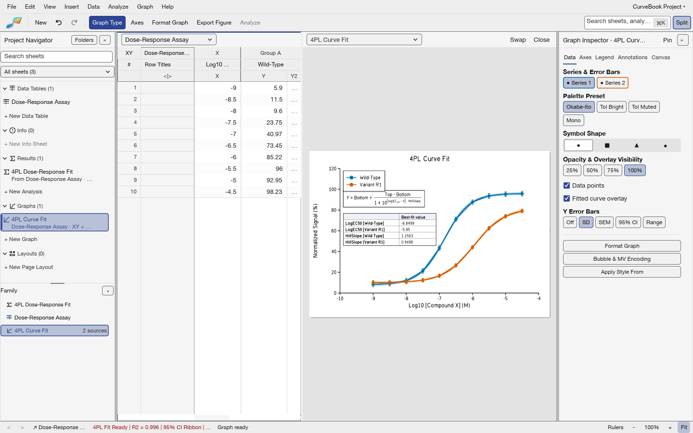
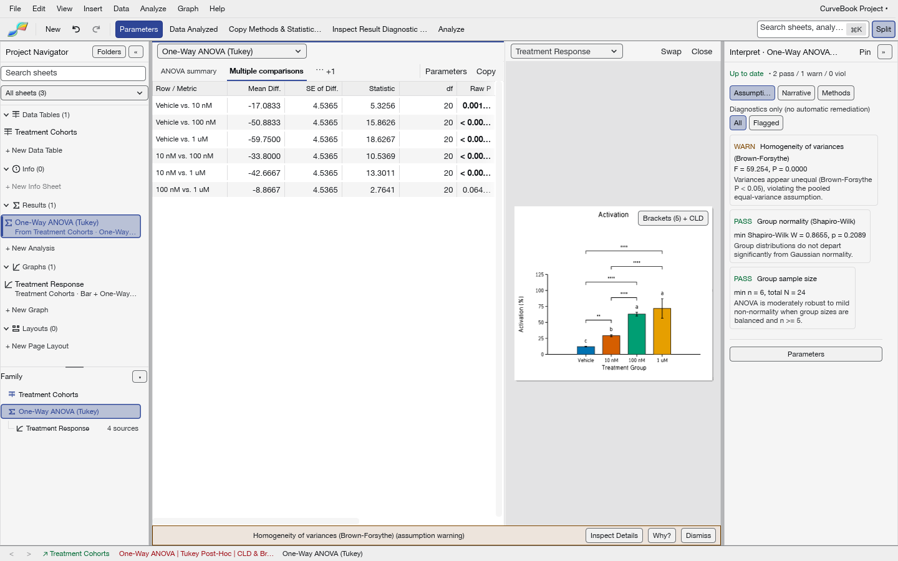
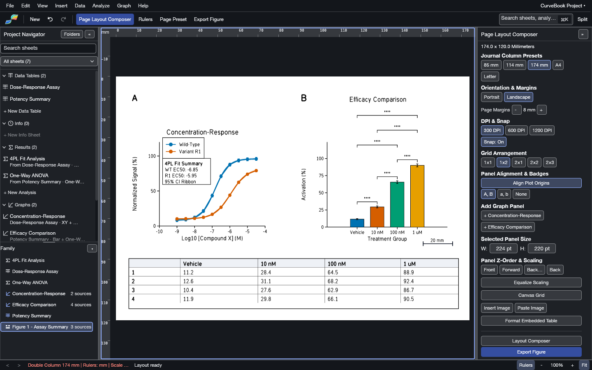

# Getting started with the desktop app (Beta)

<!-- Audience: Tier 1 Scientist Guide — keep sentences short and plain; put detailed options and schemas in tables.md, analyses.md, fitting.md, graphs.md, or files.md. -->

Use CurveBook to enter lab data, run statistical tests and curve fits, and build multi-panel figures, all offline. To install CurveBook or check your download first, see [Getting started and installation](get-started.md).

> [!NOTE]
> **About this Beta guide:** This page introduces the main workspace and dialogs. A full menu-by-menu guide and tutorials will follow after the Beta.

---

## 1. Launch CurveBook and start a project {#launch-and-welcome}

When you open CurveBook without a project file, the **Welcome to CurveBook** screen puts four starting options first:

- **Open:** Reopen a `.curvebook`, `.cbtemplate`, `.pzfx`, or `.prism` file.
- **Import:** Bring in `.xlsx` workbooks, delimited text, clipboard data, plate maps, or `.pzfx` and `.prism` files.
- **New Data Table:** Pick a core [table type](tables.md#table-archetypes): XY, Column, Grouped, Contingency, Survival, Multiple Variables, or Nested. Open **Additional table types** for **Parts of Whole**. Then choose the X-column format and raw replicates or pre-summarized values.
- **Sample Data:** Load a built-in example dataset to try tables, analyses, and graphs.

Below those four choices, **Reuse an Analysis** groups **New from Template** and **Clone Pipeline**. Start from a `.cbtemplate` file, or copy an existing sheet family onto new data. From any open project, save your workflow as a template with **File › Save Template**.

The standard menus (**File**, **Edit**, **View**, **Insert**, **Data**, **Analyze**, **Graph**, **Help**) run along the top, above a toolbar that changes with the active sheet. Press `Cmd/Ctrl+K` to open the **Command Palette**. **Workspace Presets** switch the screen layout at any time: **Default**, **Data Prep**, **Modeling**, **Publication**, or **Compact**.

From a terminal, `curvebook --help` lists the optional launch flags. For portable folders, see [settings and storage paths](settings.md#storage-paths).

---

## 2. Enter data, manage exclusions, and check quick statistics {#data-and-exclusions}

1. **Enter or paste data:** Type into the grid, or paste tabular text with `Cmd/Ctrl+V`. On Column tables, **View › Row Titles** shows or hides row titles.
2. **Open or import files:** Use **File › Open…** or **File › Import**, or drag `.curvebook`, `.csv`, `.tsv`, `.pzfx`, `.prism`, or `.xlsx` files onto the window.
   - If your project already has sheets or unsaved changes, choose **Add to current project** or **Open as new project**.
   - Minor import problems appear in **Import Warnings**, which you can reopen from the status bar or **File › Import › Import Warnings…**.
3. **Check live summary numbers:** Select numeric cells to see their count, exclusions, mean, SD, SEM, median, and sum in the **Quick Statistics** bar at the bottom ([calculators and tools](qol.md#quick-statistics)).
4. **Exclude points without deleting them:** Press `Cmd/Ctrl+E` to exclude or restore the selected cells. To record why, choose **Edit › Exclude Selection with Auditable Reason…** (`Shift+Cmd/Ctrl+E`). See [Cell exclusions](concepts.md#cell-exclusions).
5. **Add derived columns:** In Multiple Variables tables, write [`=` Calculated Variables](tables.md#calculated-variables). Use **Manage Variables…** to rename, merge, or reorder variables, or to pin reference categories.

---

## 3. Run analyses, customize graphs, and compare side by side {#analysis-and-split-graph}

Start a statistical test, curve fit, or table transform from **Analyze › Analyze…** (`Cmd/Ctrl+Shift+A`), the **Analyze** button on the toolbar, or the **Command Palette**.

- **Linked results and diagnostics:** CurveBook creates a linked result sheet under **Analyses**, with tabbed tables, an assumption-check banner, and a [methods report](qol.md#active-qol) you can produce in one click. Linked graphs update whenever your data or settings change.
- **Graphs from transforms or in batches:** In **Transform / Normalize**, check **Create a new graph of the results** to plot the derived table straight away. To build one graph per dataset with a shared Y-axis title, use **Insert › New Graph…**.
- **Browse thumbnails and reuse graph styles:** Choose **View › Gallery** to view sheet thumbnails. Click a thumbnail to open that graph directly. Hold `Shift` or `Cmd/Ctrl` to select several graphs, then choose **Graph › Apply Style From** to style them together.
- **Embed live result tables:** Copy cells from any result sheet, right-click a graph, and choose **Paste Table**. Adjust its layout, typography, and borders in **Graph › Layout › Format Embedded Table…**.
- **Customize plots and axes:** Open **Format Graph…**, **Format Axes…**, or the Inspector on the right (`Cmd/Ctrl+Shift+I`). There you can show or hide points and curves separately, switch to horizontal bars, use a right-hand Y2 axis, or make the background transparent. See [Graphs and page layouts](graphs.md) for every plot option.
- **Compare data and graphs side by side:** Choose **View › Toggle Split Data + Graph Workspace** (`Cmd/Ctrl+\`) to show a graph next to its table or results. Curves and bands redraw as you edit or exclude values, and clicking a point highlights its cell.

---

## 4. Compose multi-panel page layouts and insert images {#page-layouts}

Open **Layouts** in the Project Navigator, or choose **Graph › Layout…**, to arrange graphs, result tables, and images on a page. A dashed marker flags any broken upstream link.

- **Size and align panels:** Choose a [journal column-width preset](graphs.md#page-layouts): 88 mm (single), 130 mm (one and a half), or 180 mm (double column). **Graph › Layout › Align Plot Origins** lines up axes, and **Equalize Scaling…** matches scales. To restack overlapping panels, use **Bring Forward**, **Send Backward**, **Bring to Front**, and **Send to Back**.
- **Insert and crop images:** Add PNG, JPEG, or TIFF images with **Insert › Image…** or by pasting with `Cmd/Ctrl+V`. Drag the handles to resize or rotate. Hold `Shift` to unlock the aspect ratio or to snap rotation to 15° steps. Adjust crops and borders in **Format Image…**, and show or hide guides with **View › Canvas Grid**.
- **Check themes and color accessibility:** Switch between the **Light**, **Dark**, and **High Contrast** themes in [settings and languages](settings.md). Before you export, check your figures with the [color-vision deficiency and grayscale preview](graphs.md#palettes-and-cvd).

---

## 5. Save projects and export publication figures {#saving-and-exporting}

- **Save projects, templates, and checkpoints:** Use **File › Save** or **File › Save As…** to save a single `.curvebook` file or a `.curvebook.d/` folder that works well with Git. CurveBook will not overwrite a file saved by a newer version, and it keeps crash-recovery journals between saves ([files and interchange](files.md)). Save your workflow as a template with **File › Save Template**, or record a named snapshot with **File › Checkpoints › Create Checkpoint…**.
- **Export figures and print:** Open **Export Figure** from **File › Export › Export Figure** or the graph and layout toolbars. Pick vector SVG, PDF, or Windows EMF, or high-DPI PNG and TIFF inside that dialog. Use **File › Print** to print, or copy a figure straight to the clipboard. See [Export capabilities](graphs.md#export-capabilities) for color spaces, text outlining, and compression.
- **Export data tables:** Choose **File › Export › CSV Table…** for one table, or **Export All Data Tables…** for a whole folder. **File › Export › .pzfx file…** saves data only, without analyses or graphs. CSV exports use your locale's delimiter and decimal separator, and `.tsv` files always use tabs ([CSV rules](files.md#csv-rules)).
- **Export results and methods reports:**
  - **File › Export › CSV Results…** saves the active result tab, or all tabs, as tidy tables.
  - **File › Export › JSON Results…** saves the analysis output as machine-readable JSON.
  - **File › Export › Save Methods Report…** saves a methods summary as `.md`, `.txt`, or `.tex`. To copy it instead, use **Analyze › Copy Methods & Statistical Reporting**.
